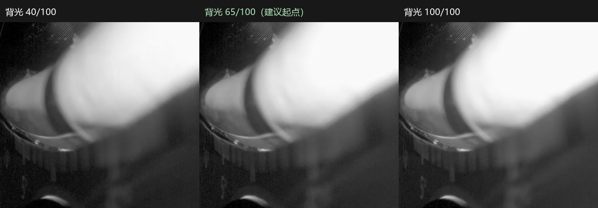

# 固定对焦后的背光比较 · 2026-10-16

建议先采用 **60–70 / 100，默认65**。已通过Wi-Fi将设备保存值从70改为65，并正常结束测试、恢复空闲。下次正式拍摄沿用65；测试结束后的熄灯属于正常行为。

这是一组固定姿态下的工程选择，并非已证明的全量程最优参数。40–100都能看到左侧候选暗影，没有哪一档能把整条刻度变清楚。未核实当前实际角度，也没有据此输出角度读数。

## 怎样比较

- 设备：CAM-211ec7045815bf02；实机报告固件3.3.14，上位机窗口显示3.3.17+20261015。
- Wi-Fi SSH使用已保存的主机指纹，并核对硬件序列号、应用设备ID、空闲状态；没有使用ADB，没有改焦距。
- 调光复用现有V3设备测试租约和 `diagnostics_backlight`，每档核对设备回复的保存亮度。正常拍摄许可保持关闭。
- 第一轮：40、50、60、70、80、90、100，从低到高再从高到低，每档每方向3张，共42张。
- 第二轮：55、65、75往返，每档每方向3张，共18张。合计10档、60张。
- 每次调光后等待3秒，再间隔约0.55秒取3张。使用现有RKiPC RTSP `/live/0`，保持1280×1080输出。
- 图片是现有HEVC视频流解码后保存的PNG，未调色、增强、锐化或改变原图尺寸；PNG并不代表未经视频压缩的传感器原始照片。拼图只作统一裁切展示。

## 观察结果

| 背光 | 暗影与邻近亮区的灰度差（越大反差越明显） | 指定亮带区域的近白占比 | 当前暗影边缘重复位置标准差（像素） |
| --- | ---: | ---: | ---: |
| 40 | 114.6 | 32.2% | 0.095 |
| 55 | 119.6 | 37.7% | 0.139 |
| 60 | 122.2 | 39.8% | 0.149 |
| 65 | 123.2 | 40.9% | 0.061 |
| 70 | 123.8 | 41.4% | 0.081 |
| 75 | 124.9 | 42.6% | 0.093 |
| 100 | 127.3 | 44.5% | 0.035 |

65提高到100，灰度差只增加约3.4%；亮带近白占比增加约3.6个百分点。当前暗影在65下重复位置较稳定，继续加亮没有带来明显可见的刻度清晰度改善。因此取60–70作为保留反差、减少不必要加亮的候选范围，65为实际工作起点。40–55也可以看到当前暗影，未据此判定低档不可用。该选择未使用一个预先验证过的综合最优评分函数。

“近白”定义为解码后的灰度≥240，计算区域见 [measurement-regions.png](measurement-regions.png)。它用于比较发白面积，不等同于确认传感器过曝。“边缘位置”是固定行范围上一条灰度剖面的半高位置，用来比较静止画面的重复性，不代表滚珠中心定位精度或角度误差。边缘10%–90%宽度约39–42像素，轮廓仍然偏软。

## 文件和复核

- [65亮度的完整原尺寸画面](refine/up-065-2.png)
- [7档往返局部对照](comparison-contact-sheet.png)
- [取样区域](measurement-regions.png)
- [全部逐图数据与各档统计](comparison.json)、[CSV统计](comparison.csv)
- 原尺寸图片在本目录和 `refine/`，各自 `captures.jsonl` 记录亮度、取图时间、帧序号、解码后图龄和SHA256；`analyze.py` 已核对60张图片哈希、尺寸和每档6张完整性。
- `before.json`、`after.json`、`refine/after.json` 和 [selection.json](selection.json) 留存配置哈希及收尾状态。配对文件、主配置、应用程序和相机配置哈希保持一致；最终亮度65、空闲、无拍摄许可、测试租约关闭、`camera_fault=false`。
- 复算：使用带OpenCV、NumPy、Pillow的Python执行 `analyze.py`，不连接仪器、不控制硬件。

## 限制和下一步

本次只比较了一个固定位置，未移动仪器到负端、零点、正端，当前姿态也没有独立角度基准。建议后续保留焦距和65亮度，在这三处各取几张：先核对暗影都能稳定看到，再决定是否把60–70作为全量程统一范围。若有一端暗影仍消失，仅增加背光未必能解决。

未做角度标定、正负分段识别、全量程精度验收或实时延迟验收。日志中的 `decoded_age_ms` 仅为电脑收到解码帧后的图龄，不是相机曝光到显示的延迟。

技术记录：本次直接通过Wi-Fi维护测试租约，上位机没有开启对应的GUI测试接收会话，设备测试线程推送到上位机的诊断JPEG可能收到409拒绝并记录 `frame_upload_failed`。本次留存图片来自独立读取的既有RTSP流，未变更上传地址或配对，也未生成正式拍摄记录；该拒绝不能当作摄像头未出图。`decoder.log`中的首段HEVC参考帧提示发生在接入既有流时；后续60张均正常解码，仍保留视频压缩这一限制。
