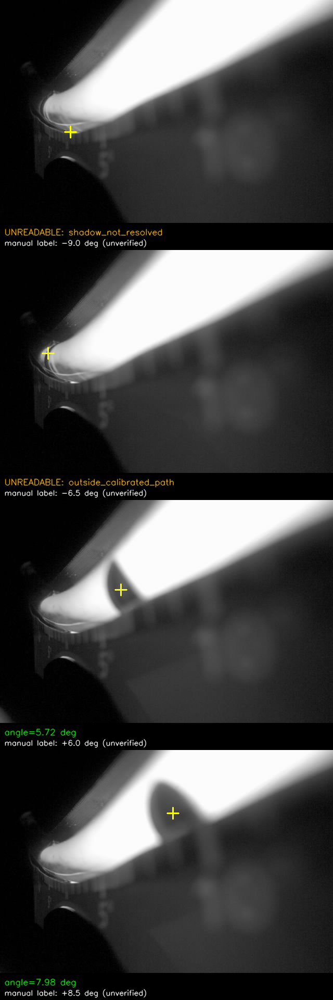
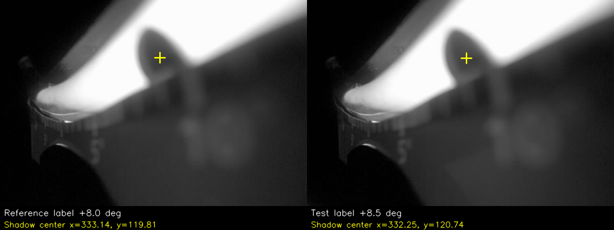

# 脊柱尺暗影读数：实现、实测与后续拍摄

日期：2026-10-15。**已实现探索版算法、照片验证、电脑实时预览入口和开发板隔离测速。尚未达到全量程±0.5°的验收条件，未切换板端正式计算。**

## 先看结果

可以把新算法理解成“读温度计”：先标定各位置对应多少度，再找滚珠的暗影到了哪里。黄色十字标出算法实际使用的暗影中心；这不是未经校准的实物球心。

| 测试图人工标签 | 本次读数 | 与人工标签差值 | 处理 |
|---:|---:|---:|---|
| -9° | 空值 | — | 暗影不可可靠分辨 |
| -6.5° | 空值 | — | 超出可用标定轨迹，不外推 |
| +6° | +5.719° | -0.281° | 有可用定位 |
| +8.5° | +7.983° | -0.517° | 有可用定位，但与标签差值超过0.5° |

**“有可用定位”不表示已经证明测量精度。**21张参考图和4张测试图均来自现有目录；角度由人工看尺命名，测试集的独立采集条件未核实。程序没有使用测试标签调整标定节点或把读数推高到筛查阈值。

[逐图定位与读数](evaluation/README.md) · [完整结果与扰动检查](evaluation/results.json) · [21个标定位置](calibration/reference_positions.json)



参考图“8°”的暗影中心x约333.14，测试图“8.5°”约332.25，相差不足1像素。按目前的位置模型，两者很接近，不能靠增加小数位解决；需要现场核查标签和拍摄一致性。这不是对标签错误的定论。



## 哪些性能已经测过

| 项目 | 结果 | 证明范围 |
|---|---|---|
| Windows计算核心 | 单帧p95约0.50ms | 640×480存储图片，仅算法核心 |
| 电脑解码与常驻计算 | 稳定阶段约6.02次/秒；本机解码后到结果p95约37ms | 6秒本地无损测试视频；包括取最新帧、真实FFmpeg解码及原生计算，不是RTSP现场验收 |
| 开发板原生计算 | 300次；p50=20.43ms，p95=32.36ms，最大58.21ms | 真实Pico Zero、640×480存储图片、RKiPC进程存在；没有同时录像 |
| 开发板子进程峰值内存 | 19612KiB，约19.2MiB | 包括标定加载；不是正式录像并发预算 |
| 现场RTSP探测 | 已连接，尺寸1280×1080 | 仅确认流和尺寸；元数据帧率不代替实测频率 |
| 拍摄到显示≤0.5秒 | **未验证** | 原始曝光时钟未与电脑建立可核对关系，日志该字段为null |

每秒6次对应每次约166.7ms的总预算。开发板32.36ms只是当前小图的核心计算，不能据此宣称原生1280×1080取图、录像、计算、上传也已经满足目标。

详见[板端原始测速](board-native-benchmark.json)、[电脑管线测速](pc-pipeline-smoke.json)、[Windows构建来源](windows-native-build.json)。板端设备序列号`41eda5f2c5b00de1`，当时固件3.3.11；测速前后业务状态、配对、背光、拍摄记录文件哈希一致，没有重启服务或写入业务视频。

## 已实现的软件

- 原生计算核唯一源码：WSL `Luckfox-Ubuntu-22.04:/home/guanjx/luckfox/Scoliosis/tools/ruler-vision`，提交`be5777f`。C11，无OpenCV/ONNX运行时，已构建Linux、Windows、ARM/uClibc版本。
- 使用固定区域的亮度校正、安装基准检查、连通暗影定位和位置表插值。多个暗影、暗影不足、离轨、尺寸不符、超出标定范围时拒绝读数。无效标定节点之间也不插值。
- Flutter拍摄页新增“实时读数”：常驻FFmpeg解码现有RTSP，单槽保留最新帧，串行常驻计算，目标6Hz。无积压历史帧队列；切页、切换仪器、断流、停止时清空当前读数并释放自己的进程。
- 当前读数画面若在本机超过500ms则不再显示；这不等同于已验证拍摄到显示延迟。
- 每个工作空间、每台仪器单独导入标定；检查设备归属、精确尺寸、SHA256及原生完整内容，保留上一份标定供回退。640×480探索标定没有绑定实际仪器，不会自动套到1280×1080视频。
- 预览日志在工作空间`logs/ruler-preview`，含算法/标定版本、帧序号、定位点、失败原因及本机时间。它不写入学生正式结果，正式ONNX分析器保持原有行为。
- Windows程序已构建到`D:\code\Scoliosis\ScoliosisFlutter\build\windows\x64\runner\Release\scoliosis_flutter.exe`，需使用完整Release目录。

**尚未接入的正式板端能力**：RKiPC原始帧出口、正式计算worker、拍摄编号与MP4 PTS映射、角度结果的持久化补传。当前的常驻计算协议只消费灰度帧并输出序号；不能把它说成已经完成上述正式链路。由于现有成像/标定尚未过关，本轮没有部署这些能力，也没有用诊断JPEG轮询冒充6Hz。

## 如何重现照片验证

PowerShell中使用可用Python环境（需NumPy、OpenCV），先运行Flutter仓库`tool/build_shadow_reader.ps1`构建Windows读数程序。原有两份参考代码和所有源照片未修改。

```powershell
$python = 'C:\Users\31186\.cache\codex-runtimes\codex-primary-runtime\dependencies\python\python.exe'
$tool = 'D:\code\Scoliosis\Luckfox\调试\工具\ruler_vision.py'
$reader = 'D:\code\Scoliosis\ScoliosisFlutter\thirdPartyLibrary\ruler-vision\ruler_reader.exe'
& $python $tool calibrate --references 'D:\code\Scoliosis\PythonProject\reference set' --reader $reader --output 'D:\code\Scoliosis\Luckfox\调试\记录\ruler-vision-next\calibration'
& $python $tool evaluate --profile 'D:\code\Scoliosis\Luckfox\调试\记录\ruler-vision-next\calibration\calibration.json' --tests 'D:\code\Scoliosis\PythonProject\test set' --reader $reader --output 'D:\code\Scoliosis\Luckfox\调试\记录\ruler-vision-next\evaluation'
```

输出目录存在时拒绝覆盖。正式安装补拍时，`calibrate`还需传`--device-id CAM-实际序列号`，并使用当前相机原始分辨率。不要只改JSON中的尺寸、拉伸图片或更换设备ID来绕过不匹配检查。

## 下一轮怎样拍，为什么要这样拍

1. 先只比较负端、零点、正端三种位置，微调相机斜角、距离、中部对焦和补光。目的是三处都有可辨认的暗影，而不是把某一侧刻度调到最锐。
2. 亮带已经发白，先降低或改变补光方向；盲目加亮不能恢复失焦细节。锁定最终安装后才采集新的标定照片。
3. 使用原始1280×1080图片。覆盖实物尺两端和全部量程，建议先每1°一组，每组保持静止取多张；零点及相邻半度位置另采测试图。
4. 同一角度分别从正方向、负方向转到，重复至少3轮，检查滚珠停稳和方向差异；标定与测试分轮采集，不能用相邻视频帧同时充当训练和独立测试。
5. 当前仍按人工标签评价“一致性”。后续有独立角度基准时，另记录其误差，才能正式核验±0.5°。
6. 同安装标定通过后，再测正式分辨率、并行录像、实际Wi-Fi下的更新率、真实拍摄到显示延迟、峰值内存和录像完整性，决定是否采用板端计算。

## 检查、追溯与回退

- Flutter全套`flutter test --no-pub --concurrency=1`：139项通过；另有真实FFmpeg与常驻原生进程的联调测试。
- `dart analyze lib test tool/shadow_live_smoke_test.dart`无问题。早先全目录`flutter analyze`还报告build内旧测试夹具和既有工具脚本告警，未为本任务更改其代码或分析排除配置。
- Linux/Windows原生协议检查通过：有符号读数、失败空值、截断帧、多暗影、7组非法标定；Linux ASan/UBSan同组检查通过。
- Windows Release构建、运行时清单校验另见`verification.json`。构建成功不代表现场实时或精度验收完成。
- GitNexus已在编辑前检查影响范围。新增计算核与权威源码按哈希核对后索引，提交前`detect_changes`仅涉及新增模块的2条流程、MEDIUM风险；详见`gitnexus-core.json`。原ONNX分析器、采集状态机没有修改。
- 回退：停止实时读数即可继续原有拍摄/正式分析；导入失败不覆盖旧标定，上一份保存为`.previous`。本轮未更新正式固件、未移动既有tag、未更改旧归档。

原始记录与当前限制必须一起保留，不能把算法成功定位、交叉编译成功或单帧测速当成全量程、实板并行录像或临床有效性的证明。
