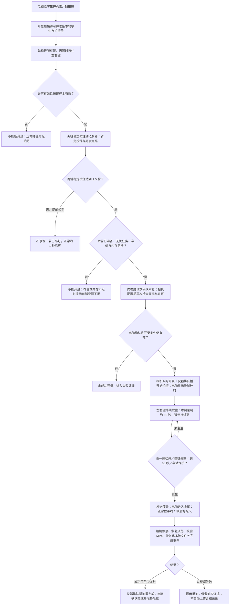
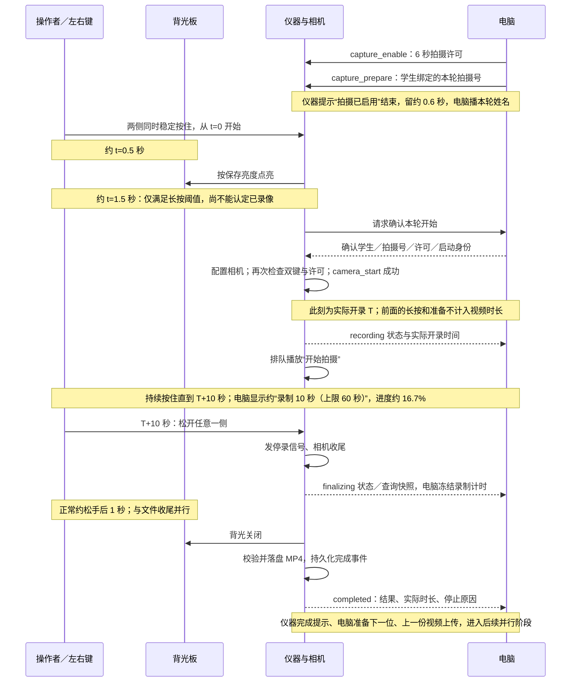
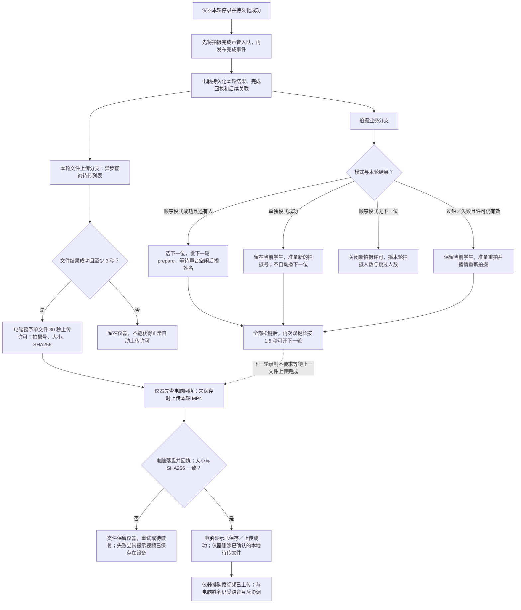
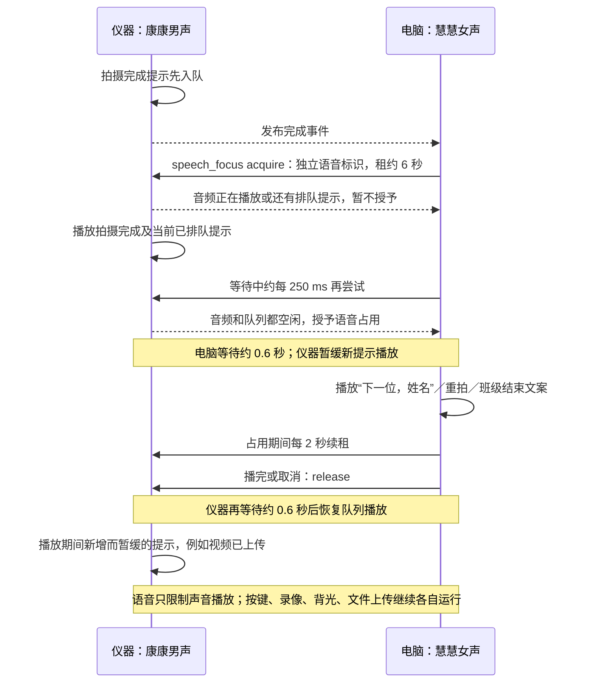

# 左右按键、背光、语音与电脑进度：10 秒录像案例

核对日期：2026-10-14（北京时间）。本说明讲解**当前 V3 按键录像流程**。

- 下位机权威源码：WSL `/home/guanjx/luckfox/Scoliosis`，提交 `0da42c7cd01eba3d5d14019c76bcc64a92dc0670`，版本 **3.3.11**。
- 上位机源码：`D:\code\Scoliosis\ScoliosisFlutter`，提交 `b0b6ae4eb543ebf49f3c478aaff9c0d726ecb031`。本文没有核对正在运行的上位机 EXE 来源。
- 本次只读实板核对：USB 序列号 `41eda5f2c5b00de1`；程序及状态版本均为 **3.3.11**；`/opt/instrument/state/backlight.json` 保存亮度 **10%**。这是保存值，不能据此断言此刻灯已点亮。
- 下面时间线来自当前源码；**本轮未进行 10 秒实拍、实际喇叭听感或物理按键验收**。图中固定的 0.5 / 1.5 / 1 / 0.6 秒是代码阈值，实际观察还包含消抖、主循环、通信及驱动延迟。

## 1. 最先确认：10 秒指哪一段

当前是**按住录制、松开停止**，并非自动录满 10 秒。

**左右两键一起稳定按住 → 约 0.5 秒背光亮 → 约 1.5 秒满足开录条件 → 电脑确认及相机启动 → 实际录制 10 秒 → 松开任意一侧 → 停录和收尾。**

“按下后总共 10 秒就松手”通常得到不足 10 秒的视频，因为前面的 1.5 秒长按确认及开录准备不属于录像时长。要得到约 10 秒的视频，应从电脑进入“录制 XX 秒”阶段观察计时，达到约 10 秒后松手。电脑状态更新有延迟，最终时长以仪器完成事件记录的 `duration_ms` 为准，不能保证人工松手精确得到 10000 ms。

这里“拍摄”实际采集的是 **H.265 编码的 MP4 视频**；上限为 **60 秒**，少于 **3 秒**判为过短。正常流程没有“10、9、8……1”的倒计时声音，也没有每秒报数。

即使配置中的旧 `duration_ms` 是 10000，当前 V3 的 `capture_controlled` 路径也走“按键停止／60 秒保护”，不会据此固定在 10 秒停录；按配置定时的分支是另一条无控制通道的旧录制路径。

## 2. 四张流程图

配套可直接浏览的图示：[流程图.html](流程图.html)。单张图可独立放大：[01 总流程](01-总流程.svg)、[02 前后时间线](02-前后时间线.svg)、[03 完成后的并行流程](03-完成后的并行流程.svg)、[04 语音协调](04-语音协调.svg)。同名 `.mmd` 是可编辑 Mermaid 源文件。

### 图 1：按键到停录总流程

### 图 2：前后时间线

### 图 3：完成后，下一位与上传分开推进

### 图 4：仪器提示与电脑姓名的互斥

## 3. 开拍前：电脑先准备，仪器按键后触发

### 3.1 点击电脑的“开始拍摄”不会立即启动相机

电脑检查学生资料、模式、设备配对与通信状态；顺序模式要求已选学校、年级和班级。随后将学生、本轮 `capture_id`、许可 `gate_id` 关联并保存。

电脑发送 `capture_enable`（许可最长 6 秒），仪器确认后再发送 `capture_prepare`（本轮拍摄号）。电脑每 2 秒续租，保持这份许可有效。该许可与语音占用是两份独立租约。

仪器开启许可时排队播 **“拍摄已启用”**，电脑的自动姓名播报等待仪器语音及队列空闲，取得占用后留约 0.6 秒再播放：

- 顺序模式首次开始：“年级、班级，第一位，姓名”。
- 单独模式首次开始：学生姓名。
- 后续顺序模式：“下一位，姓名”。

这些动作完成后，相机仍在等待物理左右按键。日常操作应听完当前学生姓名，再开始双键长按，便于核对拍摄对象；当前代码并没有把“姓名播完”设为开录硬条件。

### 3.2 左、右、中键各做什么

| 操作 | 当前行为 |
|---|---|
| 只按左键或只按右键 | 不满足正常点灯或新开录的双键条件 |
| 先按左键再按右键，或反过来 | 可以；0.5 / 1.5 秒计时从两侧都稳定按住时开始，不从第一侧按下开始 |
| 双键稳定按住不到约 0.5 秒就松手 | 不开录，正常不会触发拍摄背光点亮 |
| 双键稳定按住约 0.5～1.5 秒后松手 | 可能已亮灯，但未达到开录阈值；已亮灯正常延迟约 1 秒关闭 |
| 双键稳定按住至少约 1.5 秒 | 条件满足后进入开录请求与相机准备；不代表这一刻必然已录到视频 |
| 开录后持续按住左右两侧 | 继续录像，最多约 60 秒 |
| 开录后松开其中一侧 | 请求停录；不必等两侧都松开才结束 |
| 完成本轮后再开下一轮 | 先松开所有键，再双键重新长按；不能一直按住让仪器自动连续录多个学生 |
| 中键长按约 3 秒 | 已配对时请求解除配对；未配对时切换约 45 秒配对窗口。它不是拍摄键 |
| 三键一起按 | 新开录要求“仅左右键”，三键不符合；录制中两侧仍按着并不因中键瞬时按下立刻停止，但中键长按触发解除配对会要求停录，正常拍摄不要混按中键 |

GPIO 对应：左 `GPIO0_A3`（编号 3）、中 `GPIO0_A4`（编号 4）、右 `GPIO0_A0`（编号 0），低电平按下。位掩码分别为左 1、中 2、右 4，仅左右同时按下为 **5**。

按键由独立采样进程约每 **10 ms**读取，按下与松开均配置 **30 ms**消抖。启动时已经按住、读取失败或采样失效时采用禁止触发的保护；需实际全松键后重新按。不能把“物理接点刚接触”当作“软件已认定稳定按下”。

## 4. 背光板：先亮、持续、松手后正常延迟灭

### 4.1 正常拍摄中的背光

正常拍摄点灯同时要求：拍摄许可有效、按键样本有效、当前不是解除配对状态，以及此前完成松键解除保护。左右两键稳定按住约 **500 ms**后，按仪器保存的亮度点亮。

灯光计时与录像计时分开：灯可在相机尚未开录时先亮；录像开始后两侧持续按住，灯持续亮；一侧松开后，灯正常再保留约 **1000 ms**，然后关闭。该延时并不等待 MP4 校验、上传或电脑播报，因此**灯灭不证明视频已保存到电脑**。

3.3.11 的正常拍摄使用 `/opt/instrument/state/backlight.json` 保存亮度。本次读到 **10%**。保存值为 0 时，“点亮”请求实际输出仍是 0%；有效保存文件缺失或值不合法时源码回退为 100%。

3.3.11 不会仅因为一次业务主循环耗时超过 100 ms 就主动关灯；但独立按键采样本身陈旧或失效仍触发保护。背光接口失败会记录失败并将内部点灯状态清除；当前代码没有将“背光硬件已确认点亮”作为启动录像的强制条件，故不能仅凭灯或声音判断是否实际录像。

### 4.2 哪些情况不遵守“松手后 1 秒”

| 情况 | 背光表现 | 已经开始的录像 |
|---|---|---|
| 正常松开一侧，许可仍有效 | 正常约 1 秒后灭 | 请求停录、进行收尾 |
| 许可过期、电脑关闭许可 | 正常拍摄背光立即进入关闭请求 | 关闭许可自身不强制中断已开始的录像；仍依靠松手、60 秒上限等停止条件 |
| 按键样本无效 | 关闭请求 | 请求停录，避免误认仍按住 |
| 解除配对 | 关闭请求 | 解除配对流程请求停录并收尾 |
| 正处于“设备测试”诊断模式 | 由诊断亮度控制 | 正常拍摄按键流程被屏蔽，不能按正常拍摄表解释 |

进入“设备测试”时灯先关闭，界面读取并展示保存亮度；调整或测试后才按所选值点亮并保存。离开诊断后恢复正常拍摄手势。**设备测试灯光与拍摄灯光是两个运行模式。**

## 5. 以实际录像 10 秒为例逐步查看

假设通信正常、学生已准备、诊断关闭、保存亮度大于 0；先听完当前学生播报。令双键被软件认定稳定按住为 **t=0**，令相机真正开始录像为 **T**。

| 顺序 | 时间 | 左右按键 | 背光板 | 仪器／录像／声音 | 电脑显示或动作 |
|---|---|---|---|---|---|
| ① | t 之前 | 全部松开 | 正常关闭 | 已收到拍摄许可和本轮拍摄号；排队“拍摄已启用” | 学生绑定已保存；取得语音占用后播本轮姓名；等待左右键 |
| ② | t=0 | 两侧稳定按住 | 尚未因本次手势点亮 | 开始双键长按计时 | 仍是等待按键，不应计入录像秒数 |
| ③ | 约 t=0.5 s | 仍按住两侧 | 按保存值点亮，本机为 10% | 尚未开录 | 仍等待；亮灯不代表已经开录 |
| ④ | 约 t=1.5 s | 仍按住两侧 | 持续亮 | 检查本轮准备、忙状态、存储与内存；请求电脑确认 | 接受本轮开始请求后进入 `starting`；主拍摄条仍映射到等待状态，记录列表可显示“准备开录” |
| ⑤ | T，随 HTTP/相机启动耗时变化 | 必须仍按住 | 持续亮 | 相机配置后再次检查双键及许可；`camera_start` 成功，进入真正录制；排队“开始拍摄” | 收到 `recording` 或查询快照后显示“录制 XX 秒（上限 60 秒）” |
| ⑥ | T+1～9 s | 持续按住 | 持续亮 | 录像持续；没有每秒提示音 | 显示正计时；示例 1 / 5 / 9 秒进度约 1.7% / 8.3% / 15% |
| ⑦ | 约 T+10 s | 松开任意一侧 | 正常开始约 1 秒延迟灭灯 | 消抖及循环确认后发停录信号，调用相机停止 | 收到收尾状态／快照后显示“录像收尾中”，不再把收尾耗时累计为录制时长；10 秒进度约 16.7% |
| ⑧ | 正常约松手后 1 s | 已松开，下一轮前全松 | 关闭 | 关灯与相机停录、文件校验并行，谁先结束取决于耗时 | 可能仍在收尾，也可能已收到完成事件 |
| ⑨ | 文件收尾完成，时间不固定 | 全松 | 关闭 | 确認 MP4 完整，落入本地待传目录，持久化元数据及完成事件；先将“拍摄完成”入队，再通知电脑 | 保存本轮结果与时长；顺序模式可选下一位；上一轮显示“拍摄完成，等待上传” |
| ⑩ | 当前仪器语音队列空闲以后 | 下一轮尚未按键 | 关闭 | 授予电脑语音占用；暂缓后来的仪器提示 | 再留约 0.6 秒后播下一位姓名。单独模式成功则留当前，不自动播下一位 |
| ⑪ | 与⑩并行，上传耗时不固定 | 可按下一轮，操作前核对新姓名 | 跟随下一轮手势 | 成功文件取得逐文件许可后上传 | 旧学生记录变为上传／保存状态，不强迫等上传完成才准备下一位 |
| ⑫ | 电脑已落盘且仪器核对回执通过 | 与本轮完成无关 | 不因上传而点亮 | 删除**已核对**的本地待传 MP4/元数据，排队“视频已上传” | 记录显示“已保存电脑”；对应上传人数统计更新，分析任务可开始 |

**T 不是 t=1.5 秒的固定别名。** T 还取决于电脑确认、相机参数设置、驱动启动与调度；音频 1.92 秒的“开始拍摄”是在实际开录后排队播放，不是必须播完后才开录。应以录像状态及完成时长核对，不能从语音说完的时刻重新计 10 秒。

## 6. 电脑的三类“进度”分别代表什么

### 6.1 当前学生的单轮拍摄条

| 阶段 | 文案／表现 | 当前进度含义 |
|---|---|---|
| `prepared` / `starting` | 等待左右键按住 1.5 秒 | 0%，既不是文件上传也不是录像倒计时 |
| `recording` | 录制 XX 秒（上限 60 秒） | `已显示的整秒数 ÷ 60`，10 秒约 16.7%，不是“10 秒目标”的完成率 |
| `finalizing` | 录像收尾中 | 保留录制秒数对应的比例；收尾不应继续增长录像时长 |
| `uploading` | 上传中 | 不定进度动画，没有按已传字节显示的精确百分比 |
| `pending_local` 等留机状态 | 视频留在仪器 | 图形值为 100%、警示色，代表这一状态结束了录像阶段；**不代表已上传电脑** |
| `saved` | 已保存到电脑 | 100%、成功色，只有电脑保存记录后才能视为落盘 |
| `failed` | 拍摄失败，请检查仪器 | 失败状态 |

主界面每约 1 秒刷新；录制中的本地单调计时器与仪器 `elapsed_ms` 快照协同。设备查询通常每 2 秒发起，HTTP 状态通知也可更新阶段；延迟通知不应让收尾倒退回录制。通信和调度延迟意味着 GUI 不保证与物理动作同一毫秒切换。

顺序模式接收完成事件后就会切换当前学生并准备下一轮，因此拍摄主条可能很快回到**下一位的等待按键**；上一位录像的状态请看“上一轮”摘要和记录列表，不能把下一位的 0% 当作上一位视频丢失。

### 6.2 名单里的拍摄次数

`savedCount` 同时计入成功的完成事件及电脑保存记录，并按拍摄号去重。因此**拍摄成功但尚未上传**就可能增加次数；不能仅凭次数判断电脑是否已收到文件。

### 6.3 工作空间总进度

| 总进度 | 正常 10 秒成功案例何时增加 | 不能据此断言什么 |
|---|---|---|
| 已拍摄 | 完成结果落入本地待传等已拍状态后 | 不能断言电脑已收到 MP4 |
| 上传成功 | 电脑验证并提交正式视频记录后 | 不能断言角度分析已完成 |
| 有效角度 | 分析状态完成且存在对应尺读数角度样本后 | 与长按多久、背光是否亮没有直接同步关系 |

总进度按**学生 ID 去重**，一个学生拍两次不会当作两名学生。分母是工作空间名单人数。当前“已拍摄”待传统计路径也可能包含过短视频，不能把该数字当作合格视频人数；需查看每条记录的“短片需重拍／失败／已保存”等结果。

## 7. 声音的触发条件与先后

仪器为已采用的 **Microsoft Kangkang 康康男声**，生成参数 Rate=-1，16 kHz、单声道、16-bit PCM；电脑优先使用 **Huihui 慧慧女声**，Rate=0、Volume=100（缺慧慧时源码选择其他可用中文声线）。下表时长是 WAV 文件自身长度，不含等待、设备调度与播放设备延迟。

| 声音 | 文件长度 | 何时排队或播放 | 该声音不证明什么 |
|---|---:|---|---|
| 拍摄已启用 | 2.195 s | 电脑开启仪器新拍摄许可 | 不证明相机已开录 |
| 电脑首次姓名／班级第一位 | 随文案变化 | 本轮准备确认后，等待仪器音频空闲及约 0.6 s 间隔 | 不会自动启动相机 |
| 开始拍摄 | 1.920 s | 相机已实际开录后排队 | 不是开录前倒计时，播完不是录像计时起点 |
| 拍摄完成 | 1.945 s | 视频收尾成功且实际时长至少 3 秒，完成事件发布前先入队 | 不证明已上传电脑 |
| 录像过短，请重拍 | 3.015 s | 文件流程成功但实际时长小于 3 秒 | 不会自动切到下一位成功学生 |
| 拍摄失败，请重拍 | 2.950 s | 相机／文件／开录处理失败 | 不证明只是语音失败；需看日志 |
| 存储空间不足 | 2.480 s | 开录前存储或可用内存保护不通过 | 此分支不会正常开录；这句文案也覆盖内存不足 |
| 电脑下一位姓名／请重新拍摄 | 随文案变化 | 完成事件保存、下一轮准备确认后，取得语音占用再播 | 不证明上一份视频已上传 |
| 视频已上传 | 2.375 s | 电脑存储回执的大小与 SHA256 已核对，本地已确认待传文件清理后排队 | 不证明角度分析已完成 |
| 视频已保存在设备 | 2.865 s | 一次已开始的上传／回执核对失败后排队 | 单纯暂停上传或从未取得许可，不保证一定会播这句 |
| 拍摄已停止 | 2.245 s | 拍摄许可从开启变为关闭 | **不等于正在录制的相机已停止** |
| 电脑班级结束统计 | 随人数变化 | 顺序模式本轮完成后无下一位；关闭许可后经协调播报 | 这里是拍摄成功人数与跳过人数，不是上传完成人数 |

### 7.1 为什么现在可以错开

仪器只在音频播放器和提示队列都空闲时授予 `speech_focus`。电脑等待取得占用后再留约 **600 ms**，然后播姓名；占用期间仪器新提示保留在队列，暂缓播放。电脑每约 **2 秒**续一次 **6 秒**租约，播完或取消后释放；仪器再留约 **600 ms**恢复提示队列。

所以正常顺序是“仪器当前提示播完 → 留间隔 → 电脑姓名 → 留间隔 → 仪器后续提示”。但**上传与声音并行**：如果“视频已上传”已在电脑取得占用前入队，它也可能先播完，再轮到电脑姓名；如果在占用后入队，则等电脑播完再播。不能把上传提示固定画成永远在姓名之后。

语音占用**不锁住录像**。如果电脑尚在播名字而操作人员已双键长按到开录，相机仍可开录，仪器“开始拍摄”会暂缓播，随后再恢复。日常应先核对姓名并等播完再按键，避免人听到的开录声音滞后。

电脑最多等待语音占用约 **15 秒**，单次请求另有超时；姓名变化、设备切换或断连、关闭自动播报、退出等会取消对应过期语音并释放占用。电脑丢失续租时，仪器租约到期后恢复队列，不永久静音。旧版无该能力的固件只能检查音频空闲并短暂停顿，不能提供同等级互斥。

仪器提示队列有限，新录制开始会清理尚未播放的旧队列，队列满也可能丢弃新提示；语音设备错误同样可能导致听不到提示。**声音是操作辅助，业务是否成功以状态、文件与回执为准。**

## 8. 收尾、上传及异常路径

### 8.1 松手以后，不是马上发“完成”

1. 稳定松键被检测到，主进程发停录信号，进入 `finalizing`，记住停录请求时刻。
2. 录制进程执行相机停止；失败时重试一次并核对相机状态。
3. 恢复拍摄前的预览参数，找到唯一新视频，校验 `ftyp` / `moov` / `mdat` 等 MP4 结构。
4. 转入仪器 `capture/pending/<capture_id>.mp4`，同步文件及目录，持久化时长、结果、完成事件。
5. 先把对应完成／过短／失败声音入队，再发布完成通知。电脑保存结果并回确认，后续操作按结果和许可推进。

这些步骤时长不固定，不计入“10 秒目标录像”的人工等待；仪器报告的 `duration_ms`测量至调用相机停止前，编码封装最终媒体时长仍可能有小差异。

### 8.2 上传的成功判据

成功且至少 3 秒的视频才获得正常自动上传许可。电脑对每个文件发独立 `upload_grant`，带拍摄号、大小、SHA256、30 秒期限。仪器先查电脑是否已经保存同一文件，避免不明回执下盲目重复发送；未保存时上传。

电脑写临时 `.part` 文件，核对大小、H.265 MP4、MP4 结构、SHA256，再提交到工作空间视频目录并保存正式记录。仪器重新查询保存回执，对大小与哈希核对通过，才清理对应本地待传文件并排队“视频已上传”。上传失败时本地文件保留，后续可继续核对和重试。

“下一位准备”与“上一份上传”分离。前一文件上传可与下一轮按键、录制、声音协调并行；同一仪器上传进程一次处理一份文件，电脑每个授权周期给一份，保护续租及停止命令的响应。

### 8.3 需要特别分清的分支

| 分支 | 前后逻辑 |
|---|---|
| 1.5 秒之前松手 | 尚未进入本轮录像；已点亮的灯正常延迟灭；不应期待“拍摄完成”或视频文件 |
| 阈值已到，开录准备中松手 | 相机启动前会再次检查键态和许可；若条件失效，不允许实际开录，失败记录可能出现 |
| 录像不足 3 秒 | 成功落片也判过短，保留当前学生重拍，不正常自动上传；不是正常成功推进下一位 |
| 始终不松手 | 录制进程约 60 秒保护停录；必须全松后再开新一轮。在许可仍有效且双键始终按住时，背光不因“达到 60 秒”单独关闭，仍跟随手势／许可控制 |
| 录制前存储／内存不足 | 检查按 60 秒上限预估空间，阈值至少 100 MB，可用内存至少 32 MB；提示存储空间不足并要求松键再试 |
| 录制中剩余空间不足 | 录制进程周期检查，低于 16 MB 可触发保护停录，停止原因为 `error`。当前完成结果主要按文件处理是否成功及长度判断，因此文件收尾成功且至少 3 秒时仍可能写 `success` 并推进下一位；不能假设保护停录必然显示“拍摄失败”，核对时同时看 `result` 与 `stop_reason` |
| 网络断开／许可过期 | 不允许新开录、正常拍摄背光关；已开始的录像不因“关闭许可”这一动作立刻强制停录，松键／上限等仍有效。完成事件及本地文件供恢复后核对，不能继续自动准备下一位 |
| 电脑点“停止拍摄” | 调用的是关闭拍摄许可，不是立即停相机。当前录像应松开左右键并等待收尾；不要仅听“拍摄已停止”就认为录像已停 |
| 解除配对 | 仪器撤销许可并请求当前录制停止，完成收尾后处理解除状态，不套用普通“只关闭许可”分支 |
| 播放声音失败 | 有效开录不被声音失败否决；记录语音错误，拍摄及上传流程可继续 |
| 相机／封装／文件失败 | 可触发相机故障标记和关闭许可；是否能准备重拍取决于故障恢复及许可仍有效，不能保证失败后自动重拍已准备 |
| 完成事件重复到达 | 按事件号及拍摄号核对已有回执；不重复推进学生和重复记一次结果 |
| 上传或保存回执丢失 | 先核对电脑已有文件的大小与哈希；未经确认不清掉本地待传文件 |

## 9. 源码位置与复核入口

WSL 下位机路径以下均相对 `/home/guanjx/luckfox/Scoliosis`；Windows UNC 只作为只读跳转入口，不是另一份下位机源码。

| 内容 | 当前实现位置 |
|---|---|
| 左右键掩码、GPIO、低电平 | `src/platform/luckfox_gpio.c:40` |
| 10 ms 采样、30 ms 消抖、全松解除保护 | `src/middleware/buttons.c:28`，`third_party/lwbtn/include/lwbtn_opts.h` |
| 500 ms 亮灯、松手 1000 ms 灭、许可失效灭 | `src/middleware/buttons.c:114` |
| 持续 1500 ms 的开录判断 | `src/app/policy.c:3`，`src/app/runtime_v3.c:1187` |
| 开录请求、资源保护、开始声音、停录处理 | `src/app/runtime_v3.c:288`、`:385` |
| 相机准备、60 秒限制、文件收尾 | `src/middleware/capture.c:100` |
| 完成声音先入队再通知 | `src/app/runtime_v3.c:323` |
| 仪器语音占用与队列 | `src/app/runtime_v3.c:494`、`:865` |
| 背光亮度保存、诊断亮度、启动加载 | `src/app/runtime_v3.c:989`、`:1134`，`src/platform/light_test.c:288` |
| 逐文件上传及核对回执 | `src/app/runtime_v3.c:616` |
| 仪器文案和 WAV 时长 | `sounds/stability-voice-manifest.json` |
| 上位机开启与续租许可、后续准备 | `lib/app/app_controller.dart:1965`、`:2189`、`:2462` |
| 单轮文案与 60 秒进度 | `lib/app/app_controller.dart:53`，`lib/ui/pages/capture_page.dart:533` |
| 电脑录制快照与计时 | `lib/app/app_controller.dart:2231`、`:1241` |
| 拍摄次数／工作空间统计 | `lib/app/app_controller.dart:451`、`:159` |
| 学生、本轮结果、下一轮绑定的事务 | `lib/survey/survey.dart:898`、`:956` |
| HTTP 状态与 MP4 保存验证 | `lib/net/instrument_server.dart:346`、`:578` |
| 600 ms 间隔、15 s 等待、6 s 语音占用 | `lib/audio/speech_coordinator.dart:13` |
| 电脑慧慧声线 | `lib/audio/name_speaker.dart:25` |

GitNexus 用于定位调用关系；发现导航索引较源码落后时，本文以本轮直接读取的权威源码及上述提交为准。后续固件或上位机变更后，应重新核对阈值、声音时机及状态映射。
