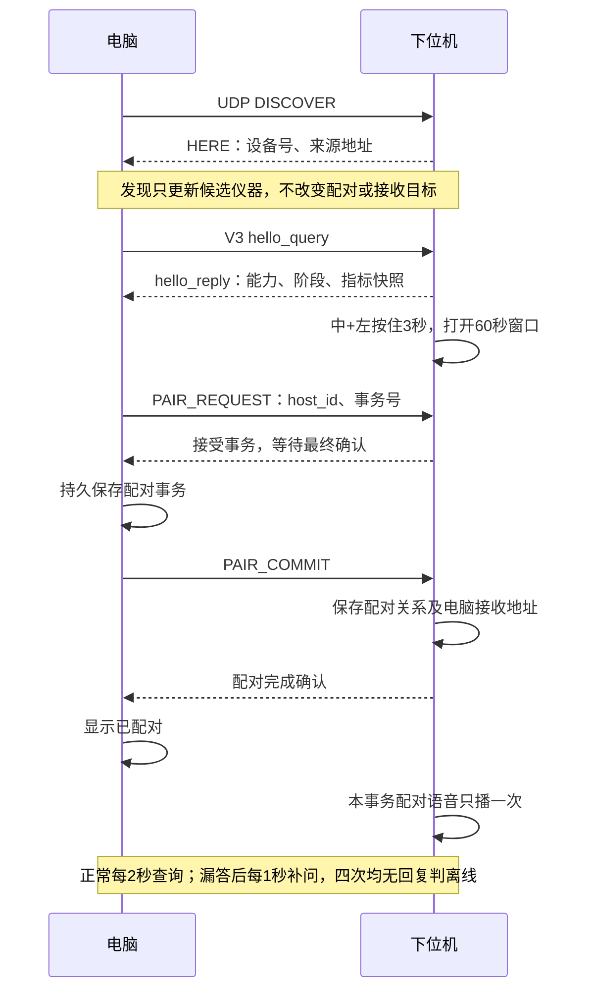
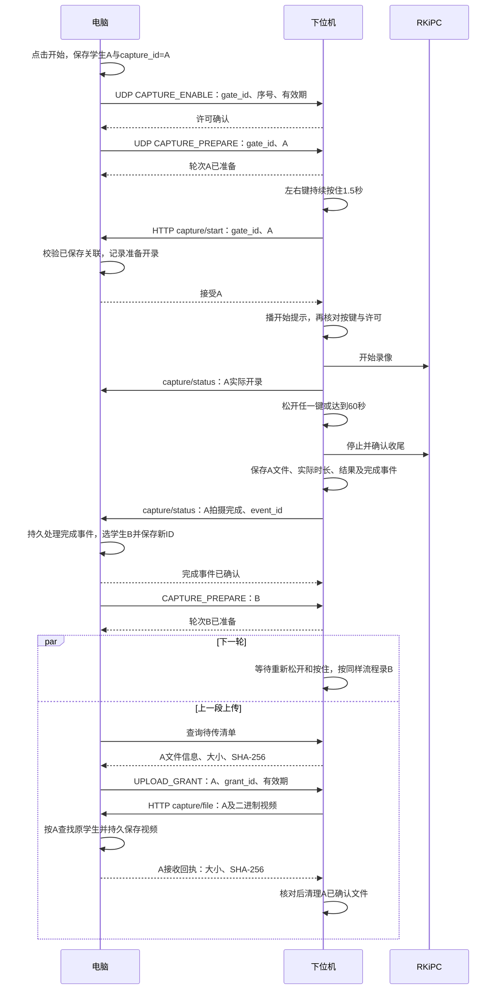
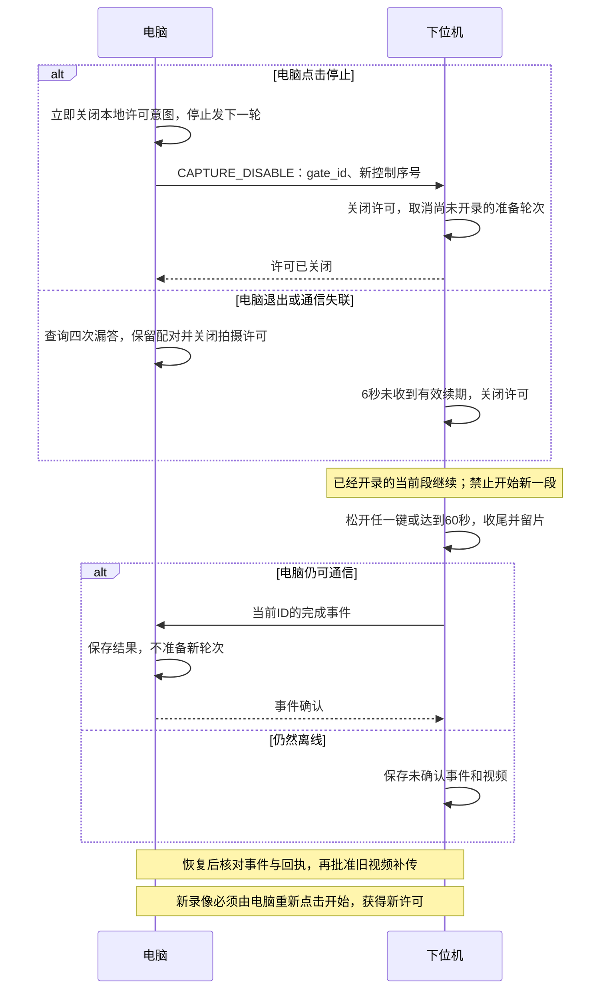

# Wi-Fi、配对、状态语音与多轮按键拍摄实施计划

修订时间：**2026-10-01 10:18，北京时间**。

拟保存文件：

`D:\code\Scoliosis\Luckfox\调试\软件架构\WiFi配对与状态语音_上下位机实施计划_2026-10-01_10-18.md`

实际保存时使用当时的北京时间，文件名精确到分钟，正文记录相同时间。**本计划已保存；2026-10-01 用户授权在当前聊天通过子代理实施。验收结果另行记录，计划中的指标不视为实测结果。**

## 1. 目标与已确定规则

完整覆盖原计划中尚未完成的下位机改造。上位机复用现有学生、会话和待传记录机制，重点补充许可开关、提前分配视频 ID 和完成事件处理。

| 项目 | 确定行为 |
|---|---|
| 电脑“开始拍摄” | 开启连续拍摄许可，准备第一轮，不立即录像。 |
| 每轮学生关联 | 电脑先保存“学生 ↔ capture_id”，再下发 ID；一段视频对应一个唯一 ID。 |
| 左右键按住 1.5 秒 | 条件满足后播开始提示；播完仍按住才实际开录。 |
| 松开任一键 | 停止当前段并收尾，最长 60 秒。下一轮必须先全部松开。 |
| 正常拍摄完成 | 下位机先报告完成；电脑随即推进下一位并准备新 ID，上一段后台上传。 |
| 短片或失败 | 不推进学生，保留原 ID 和结果；重拍使用新 ID。 |
| 电脑停止或通信失联 | 禁止下一轮；已经开录的当前段继续到松键或 60 秒上限。 |
| 恢复通信、重启 | 默认关闭拍摄许可，需要电脑重新点击开始。 |

顺序模式自动推进下一位；单独模式继续对应当前学生。没有下一位时关闭许可。停止拍摄许可不取消已有视频的补传。

密钥认证、加密控制信道继续列为后续 TODO。

## 2. 现成库选择与内存约束

### 本轮采用与复用

| 功能 | 决定 | 依据 |
|---|---|---|
| 按键消抖 | **引入 LwBTN，仅使用按下、松开事件** | C11、MIT、无动态内存分配，接受毫秒时间输入，可关闭点击与周期长按功能。[官方说明](https://github.com/MaJerle/lwbtn) |
| JSON | **继续使用已有 cJSON** | 已接入工程；使用预分配打印缓冲，解析对象及时释放。[官方接口说明](https://github.com/DaveGamble/cJSON# printing-json) |
| GPIO | **复用已验证的输入读取及启动上拉配置** | 不在本轮单独引入 libgpiod；以后迁移字符设备时核对内核、chip 和 offset。[维护者仓库](https://github.com/brgl/libgpiod) |
| 事件与定时 | **使用现有 Linux `poll()`、单调时钟及 pipe** | 当前只有少量输入、socket 和任务。libuEv 是可用的 Linux 事件循环备选，本轮无需新增事件框架。[官方仓库](https://github.com/troglobit/libuev) |
| 视频上传 | **复用现有 C 二进制分块上传** | 当前代码已使用 8 KiB 数据块；不重新开发上传通路，也不为此新增 libcurl。[libcurl 官方上传缓冲说明](https://github.com/curl/curl/blob/master/docs/libcurl/opts/CURLOPT_UPLOAD_BUFFERSIZE.md) |
| 编码与封装 | **继续由现有 RKiPC 完成** | 自有程序只控制起停、管理文件和传输，保持一个编码进程。 |

MultiButton 也可静态分配，但它按 `button_ticks()` 调用次数计时。LwBTN 接受当前时间，更适合 Linux 调度环境；两者都需要业务层处理组合键和拍摄许可。[MultiButton 源码](https://github.com/0x1abin/MultiButton/blob/584881892f244a43a7c56ce005618b9d981ec10b/multi_button.c)

### LwBTN 最小集成

固定使用提交：

`226a1f50db877ccfba7b55c9fa24a556f9c56aee`，源码标记版本 `1.3.2`。

只纳入核心 C 文件、两个头文件及 LICENSE，增加本工程配置头；不复制示例或替换现有构建系统。配置如下：[固定版本配置源码](https://github.com/MaJerle/lwbtn/blob/226a1f50db877ccfba7b55c9fa24a556f9c56aee/lwbtn/src/include/lwbtn/lwbtn_opt.h)

```c
#define LWBTN_CFG_USE_CLICK 0
#define LWBTN_CFG_USE_KEEPALIVE 0
#define LWBTN_CFG_GET_STATE_MODE LWBTN_GET_STATE_MODE_MANUAL
#define LWBTN_CFG_TIME_DEBOUNCE_PRESS 30
#define LWBTN_CFG_TIME_DEBOUNCE_RELEASE 30
#define LWBTN_CFG_TIME_VARTYPE uint32_t
#define LWBTN_CFG_CLICK_MAX_CONSECUTIVE_SEND_IMMEDIATELY 1
```

- 静态保存三个按钮和一个管理对象。
- 每 10 ms 读取三键快照，转换为“按下＝1”，统一提交给库。
- 三键全部处理后，再计算左右、中左、中右组合，避免回调顺序造成误识别。
- 库回调只记录状态；1.5 秒、3 秒和 60 秒由业务层使用 `CLOCK_MONOTONIC` 计时。
- 模拟输入提交同样的原始状态快照。
- 开机已按住、读 GPIO 失败或采样长时间中断时，不凭旧状态触发长按；重新确认松开后才能开始。
- 关闭 click 时保持最后一个配置宏为上游默认值 1，避免固定版本实现中的条件编译分支引用被裁掉的成员。[实现源码](https://github.com/MaJerle/lwbtn/blob/226a1f50db877ccfba7b55c9fa24a556f9c56aee/lwbtn/src/lwbtn/lwbtn.c#L200)

### 内存预算

以下是实施约束和验收目标，**不是已测结果**。旧记录中的约 181 MB 可见内存不能当作当前可用内存。

| 项目 | 默认约束 |
|---|---|
| 业务并发 | 一个协调进程；最多一个录像控制 worker、一个上传 worker、一个串行维护 worker。 |
| 视频数据 | 沿用 8 KiB 分块读取；不将整段视频读入内存。 |
| 控制报文 | 单包最多 4096 字节；待传清单每页最多 8 项，并受报文长度约束。 |
| 队列 | 文件和完成事件落盘；内存只保存当前任务及有限分页数据。 |
| JSON | 预分配输出缓冲；解析完成立即释放；限制嵌套深度。 |
| 新增常驻占用 | 目标增量 PSS 不超过 4 MiB。 |
| 业务进程组峰值 | 录像、上传、语音同时运行时，目标 PSS 不超过 16 MiB，不含 RKiPC。 |
| 开录底线 | 实读 `MemAvailable` 低于 32 MiB 时拒绝新一段；空间低于 100 MB 时同样拒录。 |

记录 ARM/uClibc 下的结构体大小、ELF 增量及实际进程占用。没有 PSS 数据时报告 RSS 及共享内存局限，不用二进制文件大小代替运行内存。

## 3. 通信流程图

图中 `P` 为电脑，`D` 为下位机。UDP 使用现有 37020 端口；HTTP 沿用电脑现有接收服务。

### 发现、查询与首次配对



重复事务返回已有结果，不重复播报。中+右解除配对时保留 Wi-Fi、视频和解除事件；离线解除先撤销旧电脑控制，恢复后同步。

### 开启许可、多轮拍摄与后台上传



完成通知不等待上传或哈希计算。图中的下一位准备与旧视频上传可以并行。

短片、取消或失败仍报告结果，但电脑留在当前学生，准备新的重拍 ID。迟到的视频按原 ID 归属，不按当前页面学生归属。

### 停止、失联与恢复



## 4. 实施改动与接口边界

### 上位机

- **许可开关**：开始、停止和确认状态独立于单段录像状态；录像期间仍能点击停止。停止请求发出后不再发新轮次。
- **提前关联**：扩展现有会话状态，先保存准备 ID、学生、设备和会话，再下发控制；新版 `capture/start` 只消费已有关联。
- **完成事件**：一次持久处理完成结果、名单推进和下一轮关联；重复事件只确认。已完成待传学生计入已拍。
- **并行状态**：上传不阻塞下一段；旧视频到达不改变当前学生或清除新轮次。
- **显示**：新版使用实际开录时间和时长；区分等待按键、录制、收尾、待传及已保存。
- **原计划联动**：补齐配对确认、解除同步和逐文件上传许可；复用既有排序、跳过规则及姓名播报。

### 下位机

- **按键**：接入 LwBTN 和已验证 GPIO；所有开录来源共用许可、轮次、空间及按键状态检查。
- **录像**：拆分启动、录制、停止和收尾阶段；隔离阻塞语音、HTTP、RKiPC RPC及网关探测。
- **状态协调**：修正现有按“没有 pending 文件”清除活动命令的逻辑，改按实际录像阶段判断；状态文件保持单写者。
- **元数据**：保存原 ID、实际起止、时长、停止原因、结果及完成事件；上传读取该文件元数据。
- **文件验收**：容器完整性与少于 2 秒需重拍分别判断，取消固定 100 KB 门槛对短片的误判。
- **补传**：按电脑许可执行；回执不明先查询，不盲目重发或删片。只清理明确已确认的单个文件。
- **网络**：实现 V3 查询与分页清单；录制、上传期间持续回复；发现包不覆盖已配对电脑地址。
- **Wi-Fi与语音**：本地分级恢复，失败重试至少间隔 5 秒；配对、许可、录像和 Wi-Fi 各按事务或状态边沿播报。

### 必要接口与规则

| 接口 | 最小内容 |
|---|---|
| `hello_query/reply` | 现有字段，增加能力、启动标识、阶段、许可状态和当前 ID。 |
| 配对事务 | `PAIR_REQUEST / PAIR_COMMIT / UNPAIR`，保留事务回执及离线解除事件。 |
| 拍摄许可 | `CAPTURE_ENABLE / DISABLE / RENEW`，携带 `gate_id`、控制序号；每 2 秒续期、6 秒失效。 |
| 轮次准备 | `CAPTURE_PREPARE`，携带已持久关联的 ID。 |
| 完成报告 | 扩展现有 `capture/status`：事件号、结果、实际时长、停止原因。 |
| 上传 | 分页清单、`UPLOAD_GRANT`，沿用 `capture/file` 和接收回执。 |

控制请求核对设备、电脑、启动标识、序号及回声随机数。每台设备的变更控制串行发送，停止优先；普通查询不开启或续期许可。

失效许可不能被旧续期包重新开启。旧版本能力不足时明确提示，保留匹配旧版的回退工具；同一设备只运行一套拍摄和补传调度。

## 5. 验收、实施顺序与交付

### 验收

- **库与时序**：ARM/uClibc 编译；按下和松开抖动、开机已按住、两键先后按下、三键同时按下、采样中断、计时回绕及 GPIO 读取失败。
- **许可**：未开始无效；一次开启可多轮；停止、失联、重启后不能新开一段；重复或迟到控制不能误开启。
- **关联**：A、B、C 完成通知与上传顺序打乱、回执丢失及电脑重启后仍准确关联；重复完成事件只推进一次。
- **并行**：上传 A 时录 B；旧回执不清除 B；短片留当前学生，重拍使用新 ID。
- **资源**：测量空闲、录制、上传及三者加语音时的 PSS/RSS、`MemAvailable`、进程数和采样延迟；低内存、低空间拒绝新录制。
- **实板**：至少连续 20 轮，覆盖后台上传、停止、断网恢复和迟到视频；松键到提交停录请求目标不超过 100 ms，文件收尾与可播放性另验。

计划制定时仅完成源码和 GitHub 主来源核对；实施后的构建、实板与内存结果见第 6 节。

### 实施顺序

1. 保存两端程序、配置、WAV及日志基线；补齐真实下位机 GitNexus 索引，分析拟改符号。
2. 固定并接入 LwBTN，验证统一输入入口及不阻塞协调循环。
3. 完成许可、提前 ID 关联、按键可变录像及完成事件闭环。
4. 完成下一轮准备、后台许可上传和断线恢复。
5. 补齐查询、配对、Wi-Fi与语音，执行静态检查、定向测试、构建及实板验收。
6. 将完整方案、以上三张 Mermaid 图、库版本与来源、接口表和实测结果保存进同一份分钟级 Markdown；接口改变时同步更新流程图。

保留原两份说明与旧程序，回滚不删除待传视频及新增关联记录。提交前运行 `detect_changes()`。

**后续 TODO**：控制消息密钥认证、加密通信；GPIO 字符设备迁移。当前身份字段检查用于防串机和误处理，不作为安全认证验收。

## 6. 实施与实测结果

记录时间：**2026-10-01 11:21，北京时间**。按证据类型分开标注；未列为“实板通过”的项目不视为已验收。

### 6.1 构建与主机测试

| 项目 | 结果 | 证据 |
|---|---|---|
| 下位机主机编译、ARM/uClibc 交叉编译 | 通过 | `调试/记录/V3构建_2026-10-01/` |
| 真实 C 协调器 UDP 黑盒（主机） | 33 项通过 | `调试/记录/V3真实C主机黑盒_2026-10-01.json`、`V3跨端协议审查与验收矩阵_2026-10-01.md` |
| Flutter 全量测试、静态分析 | 38 项通过，无告警（含 6.3 修复后复跑） | 本地 `flutter test`、`flutter analyze` |
| 部署 | `/opt/instrument/bin/instrument_app`；部署前备份 `/opt/instrument/backups/before-capture-v3-20261001-1023.tar` | 板端文件 |

### 6.2 实板验收（`tool/capture_gate_board_e2e_test.dart`，生产上位机代码 + 真实板卡）

按键由板端模拟文件 `INSTRUMENT_BUTTON_FILE` 输入，进入与真实 GPIO 相同的 LwBTN 消抖入口。第三次运行通过，证据 `调试/记录/V3实板20轮证据_2026-10-01.jsonl`。

| 检查 | 结果 |
|---|---|
| 未开启许可时按住左右键 | 不开录 |
| 按住不足 1.5 秒 | 不开录 |
| 短片（约 0.45 秒） | 结果 `short`，留在当前学生，新 ID 重拍 |
| 连续 20 轮 | 20 段均 `success`，按原 ID 归属到第 1–20 位学生 |
| 第 7 轮录制中点击停止 | 许可立即关闭；当前段继续录完并正确归属；重新点开始后继续 |
| 后台上传 | 录下一段时上传上一段；20 段全部收到，大小、SHA-256 回执一致 |
| 电脑重启 | 20 条记录、21 个完成事件保留；拍摄许可默认关闭 |
| 60 秒上限 | 第一次运行被中断时按键停留在按住状态，板端在 60002 ms 以 `stop_reason: limit` 收尾留片（偶发证据，非专项测试） |

视频解码（OpenCV 4.13，`调试/记录/V3实板视频解码_2026-10-01.json`）：20 段全部完整解码，帧数与容器标称一致，1280×1080，约 29–30 fps。**偏差**：第 1、14、16 轮画面仅 1.43–1.57 秒，而板端报告时长约 2.45 秒，约缺 1 秒；其余 17 段与报告时长吻合。

内存（`调试/记录/V3实板内存采样_2026-10-01_run2.jsonl`，0.5 秒间隔，831 个样本无失败）：

| 指标 | 空闲 | 20 轮验收期间 |
|---|---|---|
| `instrument_app` 进程组 PSS | 约 181 KiB | 峰值 457 KiB |
| RSS | 约 587 KiB | 峰值 2328 KiB |
| 进程数 | 1 | 最多 4 |
| `MemAvailable` | 约 154 MiB | 最低约 153 MiB |

统计只含名为 `instrument_app` 的进程，不含 worker 调起的 `wget`、`sha256sum`、`aplay` 及 RKiPC。

松键时延：测试记录的 96–184 ms 是“adb 写模拟文件 + UDP 查询往返”，查询时板端仍报告 `recording`，**不能**作为“松键到提交停录 ≤100 ms”的证据，该指标仍待用板端日志时间戳单独测量。

### 6.3 验收中发现并修复

- **上位机误解除配对（已修复）**：板子被新电脑配对后，hello 回复仍带有发给旧电脑的 `unpair_event_id`；上位机查询循环看到该字段即本地解除，并反向发送 `unpair`，导致新配对立刻失效（第二次实板运行失败即此原因）。修复：`AppController._pollQueryDevices` 仅在板端报告的 `paired_host_id` 不是本机时处理解除事件。已用相同残留状态在实板复现并通过。GitNexus 影响分析：`_pollQueryDevices` 风险 HIGH（由 `initialize` 调用，影响主界面启动与 `board_repair_test`），改动限于该判断条件。

### 6.4 未验收与待处理

- **下位机：残留解除事件不清除**。新电脑配对后 `unpair_event_id` 仍保留，只能由被撤销的旧电脑确认清除。上位机已容错；下位机可在新配对提交时清除，或在 hello 中附带 `revoked_host_id`。
- **下位机：孤儿完成事件阻塞重试**。`next_event` 总是取目录中第一个未确认事件；若该事件属于已不认识它的电脑，会每 2 秒重试且永远不被确认，排在其后的事件在即时通知失败时得不到重试。
- **约 1 秒画面缺失**（3/20 段），需核对 RKiPC 开录到首帧的延迟与 `duration_ms` 计时起点。
- **短片留板**：`short` 片段不授权上传，会长期留在 `pending`，需确定清理或补传策略。
- **人工重启与解除（用户补充确认）**：第一次运行中断后，板子于 02:54（UTC）重启，02:54:49 执行本地解除。用户在本轮明确确认这些动作由自己点击操作，原日志保留，不再将它们认定为原因不明的电气故障。
- **实板未覆盖**：断网恢复与旧视频补传、低内存/低空间拒录、实体组合键手感与喇叭提示（用户确认暂缓现场测试）、松键停录时延。

### 6.5 板端当前状态

- 程序已恢复为 `S80instrument` 正常自启，读取真实 GPIO。
- 此处为旧验收时的状态；2026-10-01 后续改造已恢复原正式电脑配对身份，按键规则改为单独中键长按 3 秒，完整操作和最新板端状态见下方新记录。
- 第一次被中断运行留下的 3 段视频、事件及配对文件已移至 `/opt/instrument/backups/interrupted-run-20261001-1042/`，未删除。

### 6.6 后续改造结果

以上 6.4 为当时发现的待办，后续已处理残留解除事件、旧电脑完成事件阻塞、短片/未知视频自动上传和首关键帧缺失。最终 20 轮正常录像＋1 段短片全部解码、原 ID/哈希核对通过，最大媒体时长偏差 32 ms。实体按键、听感与镜头内计时画面仍需现场验收。当前实现、操作步骤、回滚和完整证据见[拍摄配对调试改造实施与验收](拍摄配对调试改造_实施与验收_2026-10-01.md)。旧日志和失败实验均保留。
