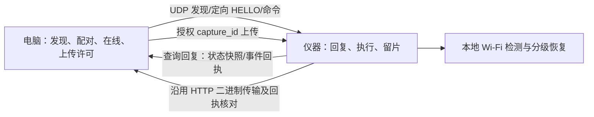
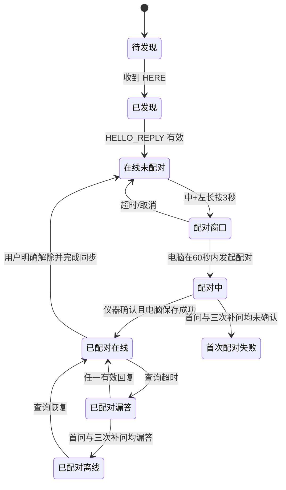

# Wi-Fi、配对、在线检测与状态语音改造计划（按键待实板验证）

日期：2026-09-30。范围：Windows 上位机 `D:\code\Scoliosis\ScoliosisFlutter` 与 WSL2 下位机 `/home/guanjx/luckfox/Scoliosis`。本文件是设计与验收计划，尚未改动运行代码、协议或板上声音。

## 1. 已确认的目标

1. **电脑负责业务闭环**：发现、在线判定、配对事务、当前仪器、拍摄调度和视频补传许可由电脑决定。仪器维护自身 Wi-Fi、采集本机指标、响应查询、执行已授权命令并保留未确认视频。物理按键等本地输入单独记录，不等于仪器自行决定配对或上传。
2. **电脑主动查询**：不再依靠仪器每约 3 秒向电脑主动发送 `/api/v1/hello` 来判在线。目标是电脑定时向指定 `device_id` 发查询，仪器回复在线状态和缓存指标。正常间隔 2 秒；漏答时改为每 1 秒补问。
3. **配对与在线分离**：首问无回复后每 1 秒最多补问三次；四次请求都没有仪器确认时，首次配对失败，既有配对设备则标为“通信离线”并保留配对关系。任一次有效回复都重置补问次数；恢复后不要求重配。
4. **上传许可由电脑发放**：包括断线后的待传视频补传。仪器只能保留文件、报告清单、在取得针对某个 `capture_id` 的有效许可后传输；电脑确认接收之前不删除板端文件。
5. **Wi-Fi 自恢复仍在仪器**：每次失败后至少间隔 5 秒再尝试，先轻量恢复，持续故障再使用断开重连。电脑查询漏答、配对失败本身都不能触发 Wi-Fi 重连。
6. **语音说清对象和动作**：Wi-Fi、电脑通信、配对关系分别命名。自动恢复过程不能播成需人工处理的“无线网络已断开”；泛称“连接成功／失败”不用于配对结果。
7. **首次配对由组合键开窗**：中+左长按 3 秒，开放 60 秒配对窗口；电脑在窗口内选择该仪器后直接完成配对，不再要求第二次实体确认。中+右长按用于解除与电脑的配对关系，Wi-Fi 不断开。按键硬件尚未实测。
8. **左+右按住录像**：两键同时持续按住 1.5 秒才算有效；仪器先播“开始录制”提示，再实际开录。松开任一键即停，最长 60 秒自动停。过短片段提示重拍；开录前存片空间低于 100 MB 就拒绝。
9. **现场拍摄只用实体键**：电脑页面最终移除“开始拍摄”，先等实体按键实板验收再撤掉旧入口。开发调试用一条 Python 指令模拟同一套按下/松开事件，并记录可追溯日志；不能另造绕过空间、配对和留片规则的拍摄路径。

## 2. 当前代码事实与旧方案冲突

| 当前事实（2026-09-30 读码） | 位置 | 对计划的影响 |
| --- | --- | --- |
| 电脑广播发现，板端 UDP 37020 回 `here`；板端收到发现包还会把 `pc_base_url` 改为广播来源。 | Flutter `lib/net/udp_discover.dart`、`lib/app/app_controller.dart`；板端 `src/net/discover.c:54` | 发现可复用，但发现包不能成为配对或上传授权。电脑身份和目标地址要校验。 |
| 板端主循环每约 3 秒 `http_hello`；电脑收到后更新 `lastHello`，15 秒内算在线；录制/上传用 `holdOnline` 掩盖心跳暂停。 | 板端 `src/app/app_controller.c:440`、`src/net/upload.c:76`；Flutter `lib/net/instrument_server.dart:83`、`lib/survey/survey.dart:56` | 要换成电脑主动查询，并处理录制 10 秒期间仍需回应的问题。 |
| 电脑点击配对就立即写入 `paired/currentId`，事件随后经下一次 hello 下发、由板端 `event-ack` 确认。 | Flutter `lib/app/app_controller.dart:638`、`lib/device/device_book.dart:119`；板端 `src/app/app_controller.c:447` | 改成“配对中 → 仪器确认 → 持久配对成功”；事件须幂等，丢回复不能重复播报。 |
| 板端一次 hello 成功后自行 `retry_one_pending()`，自动挑一个文件上传；失败后 10 秒再试。 | 板端 `src/app/app_controller.c:147,455` | 删除“板端决定何时补传”这条运行路径，改为电脑逐文件发许可。 |
| 板端有 IP 不保证可达；实板曾出现 `wpa_cli COMPLETED`、仍有 IP，但网关和电脑 ARP 不通；断开重连后恢复。现行代码每 10 秒探测网关，连续三次失败就 `disconnect + reconnect`。 | 板端 `src/net/wifi.c`、`src/app/app_controller.c:410`；[实板记录](../记录/连接重连与容量修复_2026-09-29.md) | 不能只用“有 IP”判断 Wi-Fi 健康，也不能未经对照测试就彻底去掉强恢复。 |
| Wi-Fi IP 消失立刻播 `wifi_disconnected`，恢复播 `wifi_connected`；同一文件 30 秒限频，但两个文件可以交替播。`please_connect` 在 hello 成功后播，`pair_success` 在收到配对事件时播。 | 板端 `src/app/app_controller.c:426-452`、`src/audio/audio.c:21` | 按状态边沿/事件号播报，修正文案与触发条件。 |
| 电脑设备页还写“当前连接”“断开并解除配对”“确认断开”“上次连接”。 | Flutter `lib/ui/pages/device_page.dart:138,186,197,205,628` | 改成“当前仪器”“解除配对”“上次报到”等准确文字。 |
| 板端 `button_capture_pressed()` 目前始终返回 0，三个实体按键尚未通过实板测试；当前电脑对发现的仪器可直接点击配对。 | 板端 `src/board/button.c:2`；Flutter `lib/ui/pages/device_page.dart:210` | 按键开窗、解除和组合键录像是新功能，硬件接入与消抖必须先验证；不能将离线按键拍摄写成现行实板能力。 |
| 板端 `capture_record()` 目前按 `config->duration_ms` 睡眠后停录，产品旧文要求固定 10 秒、松手不停止。 | 板端 `src/capture/capture.c:178-198`；[旧待办](实现待办.md) | 用户本轮新要求改为左+右按住录像、松开停录；必须另改启动/停止与失败收尾，旧固定 10 秒规则不再套到实体按键。 |

旧文中的多机三栏界面、`/api/v2` CONNECT 凭据、10 秒在线超时不是现行 V1；本计划以 [架构说明](说明.md) 的“一台当前设备、四页面”及当前代码为基线。配对/解除配对不能断 Wi-Fi；9 月 29 日实板已验证过配对往返时 BSSID、IP 保持不变。

## 3. 状态归属

| 独立状态 | 谁观察／保存 | 含义与切换条件 | 不得据此推断 |
| --- | --- | --- | --- |
| `WiFiState`：无 IP／可用／恢复中／需人工检查 | 仪器本地观察；电脑只能读取最近快照 | 关联、IP、网关可达性及恢复动作分开记录 | 电脑在线、配对成功 |
| `PcLinkState`：未知／在线／漏答／离线 | 电脑以有效查询回复判定 | 正常 2 秒查询，漏答后 1 秒重试；回复匹配设备号、随机号和本轮序号才有效 | 配对关系被删除 |
| `PairState`：未配对／配对中／已配对／首次配对失败 | 电脑保存唯一权威记录 | 已配对仅由用户解除或完成新的明确事务改变；临时离线不解除 | Wi-Fi 必须断开 |
| `CaptureState` 与 `TransferState` | 电脑管理学生归属/许可，仪器保存按键与文件事实 | `capture_id` 对应按键开停、拍摄、离线留片、许可、上传、回执 | 在线即可删除待传视频 |

仪器端现有 `paired=0` 同时承载“电脑暂不可达”和“未授权”的含义。实现时应拆成“最近一次电脑授权结果/有效期”和通信状态；HTTP/UDP 失败只使授权结果暂不可用，不能写成电脑已解除配对。



## 4. 目标流程与协议边界

### 4.1 发现和电脑主动查询

1. 沿用 UDP 37020 的 `DISCOVER/HERE` 找到候选仪器 IP。每轮发现保留随机 `nonce`；收到 `HERE` 只更新“已发现”，不自动设为当前、不授权配对或上传。
2. 电脑对目标 IP 定向发送版本化 `HELLO_QUERY(device_id, host_id, sequence, nonce)`。仪器核对 `device_id`、消息大小和版本，回复 `HELLO_REPLY`：原样返回 `sequence/nonce`，并带当前工作阶段、最近指标快照及快照年龄。板端只响应，不主动定时上传指标。控制消息须做身份校验；普通发现回复不等同可信控制信道。
3. 仪器每约 10 秒采样 Wi-Fi 信号、剩余存储、可用内存、电池有无等实际可读项。没有主电池时继续报告“未安装”，不虚构百分比。采样失败返回“未知+采样时间”，不把旧值显示成实时值。
4. 电脑每 2 秒发一次查询；首问超时后，在约第 1、2、3 秒各补问一次，每次给约 1 秒回复窗口。第三次补问仍超时（约第 4 秒）才判通信离线/首次配对失败。任一次有效回复立即清零补问次数，恢复 2 秒节奏；下一轮漏答重新给三次补问。旧回复、错设备号、错随机号和重复回复不得清零。
5. 录制和上传期间，仪器继续处理轻量查询并回复 `recording/uploading`；不能依赖 `holdOnline` 把真实漏答永久掩盖。按住录像的时长可能变化，必须先保证录像与网络响应互不阻塞，再切换在线判定。



### 4.2 配对事务

- 首次配对：**中+左同时长按 3 秒 → 60 秒配对窗口 → 电脑选择扫描到的设备号并点击配对 → 仪器在窗口内接受请求并回复事件号 → 电脑保存后显示成功**。窗口超时、取消或设备正在录制时不接受新配对；已配对的仪器要先明确解除，不能开窗直接让另一台电脑接管。无需输入配对码，也不要求第二次实体按键确认。
- 同一事件重发必须幂等。电脑收到有效确认并保存后才显示“配对成功”；确认丢失或超时显示“配对未完成”，不留下半配对的 UI 状态。已配对设备断线后靠已保存关系认回，无需重新按键。
- 板端收到同一事件号多次只处理一次；配对语音在电脑最终确认后播一次。**中+右长按 3 秒**发起解除配对，电脑页面也保留“解除配对”操作。离线按键解除要立即在仪器上阻止旧电脑拍摄/上传控制，并持久保存待同步的解除事件；仪器仍回答足以让旧电脑接收解除事件的状态查询。电脑恢复后撤销本地配对记录并确认同步。全过程 Wi-Fi 不断开，不删除仪器待传视频和电脑已收记录；重新配对后电脑核对旧视频清单并决定补传。
- 后续配对、上传许可等控制消息需要可校验的绑定关系与防重放随机数；不能只凭 `device_id` 或发现包来源认领设备，也不能把密钥明文放进 UDP。**单靠 60 秒窗口仍可能被同网段其他电脑抢配**；首次操作应在受控专用局域网完成，窗口一次只接受一笔事务。原 `discover_poll` 收到任意发现包就改 `pc_base_url` 的行为须在切换前收紧，不能覆盖已配对电脑。若要抵御主动中间人，需要另行使用机身密钥/USB 预置等带外校验。协议细节先核对板端现成加密能力，不自行发明加密算法。
- 升级时电脑原有的仪器名单与视频记录都保留。旧授权记录不自动变成新控制信道的安全凭据；这台仪器第一次使用新方案时，只需按**中+左**开一次窗口、在电脑点配对，之后自动认回，不涉及旧视频删除或重拍。

### 4.3 拍摄、状态与视频补传

- 电脑在查询回复中看到待传 `capture_id/size/hash` 清单后，按当前设备、记录、磁盘余量和未完成任务决定是否发 `UPLOAD_GRANT(capture_id, grant_id, 有效期)`。一次只授权一个明确文件；重复许可不造成重复归属。
- 仪器只在收到有效许可后沿用现有 `/api/v1/capture/file` 传输二进制。电脑已有的长度、MP4 头、SHA-256 与收件回执核对继续保留；断线、超时或回执不明先查询回执，不能直接重发或删片。只有“电脑已持久保存且回执匹配”才删除仪器文件。
- 正式现场拍摄由**左+右**组合键触发。电脑收到 `capture/start` 后负责锁定当前学生；离线时仪器先留片，网络恢复后电脑核对归属、记录与待传文件，允许人工处理未归属片。旧的电脑拍摄按钮和每秒拉取待拍命令，在按键实板验收并可回退后退出正式流程。
- 左+右同时按住 **1.5 秒**才算有效，释放前不创建拍摄记录；阈值满足后先播简短“开始录制”，再次确认两键仍按住，再实际开录并记录起始时刻。若播音期间已松开，就取消此次拍摄。释放任一键立即请求停录并核对 MP4 完整性，**最多 60 秒**自动停录；录制中空间跌到安全线也要收尾。少于 2 秒的片段标记“过短、需重拍”，不自动上传或删除，待电脑核对。录制中仍响应在线查询；现有固定 `nanosleep(duration_ms)` 要拆成可启动、可停止、可查询阶段。
- 所有开录来源（正式实体键、Python 调试入口，以及过渡期旧电脑按钮）都检查**实际存片目录所在文件系统**的可用空间；`free_mb < 100` 时拒绝开录并播明确的空间不足提示。现有按预计视频大小计算的额外安全余量若高于 100 MB，继续采用较高门槛。已录视频不能为了腾空间自动删掉。
- 开发专用 Python 指令接入**与物理左+右相同的按下/释放处理入口**，可指定模拟按住时长，记录命令时间、来源、设备号、`capture_id`、实际开停时间、可用空间、网络/配对状态、MP4 检查结果和后续电脑许可/回执。电脑与板端日志用同一 `capture_id` 关联，不记学生姓名或配对凭据；调试入口不得作为正式版用户操作，也不得另开未经校验的网络拍摄接口。
- 切换阶段允许保留旧 HTTP 文件接收端，但**不能同时启用新旧两套自动补传调度**。旧版板端与新版电脑的版本不匹配应有明确兼容提示和回退路径。

### 4.4 Wi-Fi 故障恢复

```text
Wi-Fi 无关联/无 IP 或网关持续不可达
  → 记故障与恢复阶段；先尝试轻量 reconnect
  → 每次失败至少等 5 秒，再检查关联/IP/网关
  → 持续故障且轻量方式无效时，才执行 disconnect + reconnect
  → 恢复后仅更新 Wi-Fi 状态；电脑能否联系仪器仍由电脑查询判定
```

网关 ARP 是局域网链路证据，不是“电脑配对失效”证据。电脑查询失败不能调用 Wi-Fi 断开。实板曾在有 IP 但网关 ARP 失败时靠强恢复成功，因此分级恢复的升级阈值、日志和冷却时间要用实板对照测量后确定，不能直接删除强恢复。

## 5. 语音与页面文案

| 实际事件 | 仪器语音建议 | 电脑页面建议／播报条件 |
| --- | --- | --- |
| 开机首次确实接入 Wi-Fi | “仪器已连接无线网络。” | 仅显示 Wi-Fi 指标；不显示“电脑在线”。 |
| Wi-Fi 不稳定，仪器开始自动恢复 | “无线网络连接不稳定，正在自动重连。”同一故障只播一次 | 显示“仪器 Wi-Fi 恢复中”；尚不能推断配对解除。 |
| 同一故障恢复成功 | “仪器无线网络已恢复。” | 电脑收到有效查询回复后再显示“仪器在线”。 |
| 多次恢复仍失败，需人工检查 | “仪器无法连接无线网络，请检查路由器。” | 明确提示检查路由器/热点，不写“配对失败”。 |
| 已发现且查询有回复，但未配对 | 可播一次“仪器已找到电脑，请在电脑端完成配对。” | “已发现 · 待配对”。不能说“请在电脑上连接”。 |
| 用户按键打开配对窗口 | “仪器已进入配对模式，请在电脑选择本仪器。” | “配对窗口已打开”；超时自动结束。 |
| 电脑在窗口内请求配对、仪器返回确认 | “仪器与本电脑配对成功。”电脑保存成功后只播一次 | “配对中 → 已配对 · 在线”；是否可拍摄还要核对学生、空间和设备阶段。 |
| 左+右有效长按 1.5 秒、即将开始录像 | 简短“开始录制”；口播后才记实际开录时间 | 显示“录制中”和实际起止时刻，不预设固定 10 秒倒计时。 |
| 松开任一键或录满 60 秒 | “拍摄完成”或对应失败提示；60 秒自动停录要说明原因 | 用实际时长、文件检查结果显示“完成／过短需重拍／留在仪器”。 |
| 用户明确解除配对且事务确认 | “仪器已与本电脑解除配对。” | 操作按钮统一为“解除配对”，不称“断开连接”。 |
| 中+右在电脑离线时解除 | “仪器已停止与原电脑配对，网络恢复后同步。”只播一次 | 电脑下次联系仪器时显示“已解除配对”；视频与待传文件保留。 |
| 首问及三次补问均无回复 | 仪器不播“电脑连接中断”；板端只播自己能确知的 Wi-Fi 故障与收到的配对事件 | 已配对设备：“已配对 · 当前离线 · 上次有效回复时间”；首次配对：“配对未完成”。 |

语音触发按“状态边沿 + `event_id` + 本轮故障号”去重，并设置恢复稳定时间。不能只靠 `audio.c` 现有“同一个 WAV 30 秒内不重复”：两种 Wi-Fi 语音仍会交替播放，而短时间内真实的二次配对又可能被误静音。`pair_failed.wav` 目前没有主流程调用；只有真实配对事务超时或明确拒绝才允许用，HTTP/UDP 普通失败不得调用。电脑上的姓名叫号 TTS 与板端状态 WAV 保持分离。最终文字须用试听文件和实板喇叭核对，文件名不等于已验证的口播内容。

## 6. 实施顺序与回滚

| 阶段 | 工作 | 完成证据／回滚点 |
| --- | --- | --- |
| 0. 基线与协议冻结 | 记录两端版本、板上二进制/配置/8 条现行 WAV、正常及故障日志；确定消息字段、超时、首次配对过渡及板端现成加密能力，写清控制消息校验方案与首次配对的受控网络边界；先用按键模拟输入验证事务，再接线实测引脚、消抖、长按和窗口；对拟改符号先做 GitNexus 影响分析。 | 当前 `DISCOVER → hello → 配对 → 拍摄 → 传输` 可复现；保存可恢复的旧版本。按键未实测不得宣布配对方案已完成。 |
| 1. 消除误导语音和 UI 词 | 将 Wi-Fi 恢复音、配对音和电脑页面文字按状态语义修正；不先改变网络控制。 | 实板配对/解除不出现“无线网络已断开”；每句有对应触发证据。可单独退回 WAV/UI。 |
| 2. 主动在线查询 | 复用 UDP 37020 增加定向 HELLO 查询/回复；10 秒状态缓存；电脑 2 秒正常/1 秒补问三次；录制期间仍可回复；增加错误和重复包处理。 | 模拟丢包及实板拔网；首问加三次补问均漏答才判离线，单次恢复回 2 秒；录制 10 秒不假离线。旧 hello 暂保留作兼容。 |
| 3. 按键开窗与配对事务 | 在实板核对组合键，接入中+左 3 秒/60 秒窗口、中+右解除；电脑“配对中→确认成功/失败”，控制消息校验及事件号幂等；发现包不得随意改已配对电脑地址。 | 窗口外不能配对；窗口内无需二次按键；首次配对超时不写已配对；中+右离线解除后阻止旧控制并在恢复时同步；回复丢失不重复语音。 |
| 4. 组合键可变时长录像 | 接入左+右 1.5 秒长按和开始语音；录像改成开始/松手停止/60 秒上限，同时保留查询响应。Python 调试指令模拟同一事件并写关联日志。 | 松开停止且 MP4 可播放；短按无误触；60 秒/低空间安全停止；断网留片。实板按键通过后，正式电脑页面撤掉“开始拍摄”；此前保留回退入口。 |
| 5. 上传许可与旧拍摄命令退出 | 电脑逐文件发补传许可；板端移除定时 `http_poll` 与自动 `retry_one_pending` 决策，保留 HTTP 视频传输及回执。正式流程只靠实体键开录。 | 电脑未许可时板端不传；许可后只传指定文件；断电/回执丢失不丢片；Python 调试与实体键产生同样的状态和日志。 |
| 6. Wi-Fi 分级恢复与现场验收 | 轻量恢复、5 秒冷却、持续故障后强恢复；语音事件防抖；在专用 2.4 GHz 路由器上复测。 | 有 IP 但 ARP 不通能恢复；电脑关闭不会触发 Wi-Fi 重连；冷热启动、电脑换 IP、板端重启、路由器重启均有记录。 |

每阶段分别验证 Flutter 定向测试/静态检查、C 交叉编译和主机检查；只有真正上板、看日志与数据回执后才记为“实板通过”。新旧通信可按版本开关回退；切换前不删除旧协议、旧 WAV 或板端待传视频。禁止批量清理。实施与部署不在本次规划范围。

## 7. 必须跑的故障场景

1. 首问与三次补问的回复全部丢失、只丢一个、晚到旧回复、错设备号回复；验证状态和恢复计数。
2. 已配对设备断网 5 秒后恢复；首次配对期间断网；中+左窗口超时/误触/录制中配对；中+右解除配对时掉线；验证配对记录、事件号与语音各播一次，Wi-Fi 不因此断开。
3. Wi-Fi 关联且有 IP，但网关 ARP 不通；电脑服务关闭但网关正常；AP 客户端隔离；电脑换 IP；验证只在本地 Wi-Fi 故障时执行 Wi-Fi 恢复。
4. 左+右短按、长按 1.5 秒后开始语音、松开任一键、未满 2 秒、录满 60 秒、录制中断网；验证仍能响应在线查询，MP4 可播放且归属与待传清单不丢；实际存片空间低于 100 MB 时拒绝开录。
5. Python 调试指令模拟同样的按下/释放轨迹，与真按键在录制时长、拒绝原因、日志 `capture_id`、上传许可上表现一致；调试日志不得记录学生隐私或控制凭据。
6. 有多个待传视频、电脑磁盘不足、许可重发、上传断线、回执丢失、电脑已收到但板端未收到 ACK；验证未经许可不上传，确认前不删片。
7. 板端喇叭试听：首次接入、自动恢复、长期故障、首次配对成功/失败、解除配对、录制开始/结束、重复事件；核对口播内容及播放次数，而不只看 WAV 文件名。

## 8. 已定按键规则与实板前置条件

- **左+右**：同时按住 1.5 秒，短音“开始录制”后开录；释放任一键停止，60 秒上限，过短片段提示重拍。开录前实际存片空间必须不少于 100 MB。
- **中+左**：同时长按 3 秒开 60 秒配对窗口；电脑在窗口内选择并直接配对，无需二次实体确认。窗口超时自动关。
- **中+右**：同时长按 3 秒解除配对，Wi-Fi 保持；电脑离线时仪器立即拒绝旧电脑控制并留待同步，待传视频和电脑既有记录都保留，重新配对后电脑批准补传。
- **电脑操作**：正式界面不再提供“开始拍摄”；必须等实体按键/回退路径实板验证后移除。开发调试用 Python 指令模拟同一按键入口并记录日志。
- **按键读取方式**：当前仓库没有现成按键库，只有返回 0 的 `button.c`。2026-09-30 只读实板检查发现 `/dev/input/event0` 属于内核 `adc-keys`，并有 `gpiochip*`；这**不能证明外接左/中/右键已映射**。先核对新按键接线、GPIO、电平、驱动映射与事件码；若内核能将三键作为输入事件提供，优先用现有 Linux 输入接口和标准 C 头文件处理组合键、消抖和长按，不另加库。若没有映射，再在现有板卡能力内选 GPIO 读取方案。板载 BOOT/RESET 和 GPIO123 不占用。

按键引脚、事件驱动能力、1.5 秒手感、喇叭时延、可变录像 MP4 收尾与 Python 调试命令都须实板验证；计划明确，功能尚未实施。
