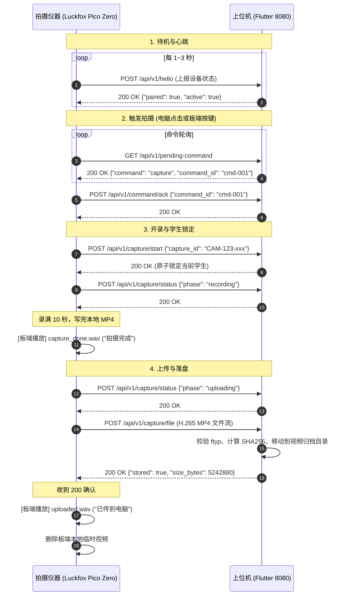

# 上位机与下位机全量 HTTP 请求与响应规范

> 路径表仍是 `/api/v1`。和当前代码不一致、对接口时以代码为准的有：`event-ack` 的 `kind` 是 `paired` / `unpaired`；视频上传 `Content-Type` 是 `video/mp4`；hello 会带 `volume`，电脑可在响应里下发音量；在线超时是 15 秒；容量字段对应待传目录所在文件系统，不是 `/userdata` 分区。

> **规范版本**：V1.0  
> **适用范围**：上位机（Flutter Windows 桌面客户端）与下位机（Luckfox Pico Zero 拍摄仪器）之间的局域网网络通信  
> **通信架构**：上位机作为 HTTP 服务端（默认监听 `http://0.0.0.0:8080`），下位机作为 HTTP 客户端，通过固化配置的 `pc_base_url`（如 `http://192.168.0.20:8080`）主动发起请求。

---

## 一、通用约定与基础规则

1. **协议格式**：
   * 接口数据默认采用 **UTF-8 编码的 JSON 格式**（`Content-Type: application/json`）。
   * 视频流上传接口为 **原始二进制数据流**（`application/octet-stream`）。
2. **标识符命名规范**：
   * `device_id`：设备唯一标识，正则约束 `^[A-Za-z0-9_-]{1,100}$`（如 `CAM-000123`）。
   * `capture_id`：单次拍摄唯一流水号，格式强制要求为 `${device_id}-${uuid/timestamp}`（如 `CAM-000123-20260929-103218`）。
   * `command_id`：电脑下发拍摄命令的唯一标识（如 `cmd-1727581234567`）。
3. **HTTP 状态码通用含义**：
   * `200 OK`：请求成功且业务正常处理。
   * `400 Bad Request`：参数格式错误、缺少必填项或视频头部损坏。
   * `404 Not Found`：请求的设备、命令、事件或拍摄记录不存在。
   * `409 Conflict`：业务冲突（如重复开始、学生已被占用、拍摄号重复等）。
   * `500 Internal Server Error`：上位机文件系统异常或内部未捕获错误。

---

## 二、接口目录速查

| 序号 | 接口方法 | 路径 | 核心业务功能 | 调用频率 / 触发时机 |
| :---: | :---: | :--- | :--- | :--- |
| **1** | `POST` | `/api/v1/hello` | 设备心跳报到、属性上报与配对状态同步 | 空闲时每 1~3 秒一次；录像中暂停 |
| **2** | `POST` | `/api/v1/device/event-ack` | 板端签收配对/解绑事件确认 | 板端收到 `pair_event_id` 并处理后 |
| **3** | `GET` | `/api/v1/pending-command` | 板端轮询待执行拍摄命令 | 空闲时常态轮询 |
| **4** | `GET` | `/api/v1/command-receipt` | 查询最后下发命令的执行回执 | 调试与诊断时调用 |
| **5** | `POST` | `/api/v1/command/ack` | 板端确认收到拍摄命令应答 | 板端取得 `capture` 命令后即时调用 |
| **6** | `POST` | `/api/v1/capture/start` | 仪器正式开录通知，电脑锁定待拍学生 | 仪器触发开录时立即调用 |
| **7** | `POST` | `/api/v1/capture/status` | 拍摄进度与阶段流转状态上报 | 录制、暂存、上传等状态切换时 |
| **8** | `GET` | `/api/v1/captures/{capture_id}/receipt` | 视频文件接收与落盘凭据查询 | 异常重试或断线恢复时核对 |
| **9** | `POST` | `/api/v1/capture/file` | 上传 10 秒 H.265 MP4 视频文件本体 | 录制完成且文件写好后单次上传 |

---

## 三、全量接口详细规范

### 1. 设备心跳与报到 (`POST /api/v1/hello`)

* **请求方法**：`POST`
* **接口路径**：`/api/v1/hello`
* **请求头**：`Content-Type: application/json`
* **请求体 (Request JSON)**：
```json
{
  "device_id": "CAM-000123",
  "ip": "192.168.0.50",
  "ssid": "ChinaNet-7HrK",
  "rssi_dbm": -65,
  "storage_free_mb": 208,
  "storage_total_mb": 238,
  "memory_available_mb": 150,
  "memory_total_mb": 256,
  "pending_count": 0,
  "camera": "ISG1321",
  "battery": "absent",
  "version": "1.0.0"
}
```
* **字段说明**：
  * `device_id` *(String, 必填)*：设备序列号。
  * `ip` *(String)*：板端当前 Wi-Fi IP 地址。
  * `ssid` *(String)*：当前连接的热点名称。
  * `rssi_dbm` *(Integer)*：Wi-Fi 信号强度。
  * `storage_free_mb` *(Integer)*：`/userdata` 分区剩余空间（单位 MB）。
  * `storage_total_mb` *(Integer)*：`/userdata` 分区总容量（单位 MB）。
  * `memory_available_mb` *(Integer)*：可用物理内存。
  * `pending_count` *(Integer)*：板端积压未传成功的视频数量。
  * `battery` *(String)*：当前固定填 `"absent"`（未安装电池）。
* **响应码**：`200 OK`
* **响应体 (Response JSON)**：
```json
{
  "ok": true,
  "paired": true,
  "received": true,
  "active": true,
  "pair_event_id": "evt-pair-001",
  "unpair_event_id": null
}
```
* **业务逻辑**：
  * 电脑收到后记录 `lastHello` 时间戳，判定设备在线。
  * `paired`：电脑端是否已与该设备配对。
  * `active`：该设备是否被选为电脑的“当前工作设备”。
  * `pair_event_id`：若电脑发起配对，此字段返回事件 ID，仪器收到后应通过 `event-ack` 签收。

---

### 2. 配对/解绑事件签收 (`POST /api/v1/device/event-ack`)

* **请求方法**：`POST`
* **接口路径**：`/api/v1/device/event-ack`
* **请求头**：`Content-Type: application/json`
* **请求体 (Request JSON)**：
```json
{
  "device_id": "CAM-000123",
  "event_id": "evt-pair-001",
  "kind": "pair"
}
```
* **字段说明**：
  * `kind`：取值为 `"pair"`（配对）或 `"unpair"`（解绑）。
* **响应码**：`200 OK` / `404 Not Found`
* **响应体 (Response JSON)**：
```json
{
  "ok": true,
  "received": true,
  "event_id": "evt-pair-001"
}
```

---

### 3. 拍摄命令轮询 (`GET /api/v1/pending-command`)

* **请求方法**：`GET`
* **接口路径**：`/api/v1/pending-command`
* **请求头**：
  * `Device-ID: CAM-000123`
* **请求体**：无
* **响应码**：`200 OK`
* **响应体 (当电脑下达拍摄命令时)**：
```json
{
  "command": "capture",
  "received": true,
  "command_id": "cmd-1727581234567"
}
```
* **响应体 (当电脑无待办命令时)**：
```json
{
  "command": "none",
  "received": true
}
```
* **业务逻辑**：
  * 电脑端采用“取走即清”机制：一旦下位机读取到 `capture`，上位机内存立即清空该命令，防止单次触发产生多次录制。
  * 未配对仪器永远返回 `none`。

---

### 4. 命令回执状态查询 (`GET /api/v1/command-receipt`)

* **请求方法**：`GET`
* **接口路径**：`/api/v1/command-receipt`
* **请求头**：
  * `Device-ID: CAM-000123`
* **响应码**：`200 OK`
* **响应体 (Response JSON)**：
```json
{
  "has_command": true,
  "command_id": "cmd-1727581234567",
  "acked": true,
  "started": false
}
```

---

### 5. 命令接收应答确认 (`POST /api/v1/command/ack`)

* **请求方法**：`POST`
* **接口路径**：`/api/v1/command/ack`
* **请求头**：`Content-Type: application/json`
* **请求体 (Request JSON)**：
```json
{
  "device_id": "CAM-000123",
  "command_id": "cmd-1727581234567"
}
```
* **响应码**：`200 OK` / `404 Not Found` (命令不存在)
* **响应体 (Response JSON)**：
```json
{
  "ok": true,
  "received": true,
  "command_id": "cmd-1727581234567"
}
```

---

### 6. 拍摄开始通知与学生锁定 (`POST /api/v1/capture/start`)

* **请求方法**：`POST`
* **接口路径**：`/api/v1/capture/start`
* **请求头**：`Content-Type: application/json`
* **请求体 (Request JSON)**：
```json
{
  "device_id": "CAM-000123",
  "capture_id": "CAM-000123-20260929-103218"
}
```
* **约束**：`capture_id` 必须以 `${device_id}-` 开头。
* **响应码**：
  * `200 OK`：成功锁定学生，允许开录。
  * `409 Conflict`：该 `capture_id` 重复或该学生正在拍摄。
* **响应体 (Response JSON - 成功)**：
```json
{
  "ok": true,
  "received": true,
  "ack": true,
  "capture_id": "CAM-000123-20260929-103218"
}
```
* **响应体 (Response JSON - 冲突)**：
```json
{
  "ok": false,
  "error": "拍摄号重复或当前学生正在拍摄"
}
```
* **业务联动**：
  * 成功后，上位机将当前高亮学生与该 `capture_id` 进行原子绑定；
  * 上位机将该设备的 `holdOnline` 置为 `true`（录像期间允许暂停发心跳而不误判离线）。

---

### 7. 拍摄阶段流转上报 (`POST /api/v1/capture/status`)

* **请求方法**：`POST`
* **接口路径**：`/api/v1/capture/status`
* **请求头**：`Content-Type: application/json`
* **请求体 (Request JSON)**：
```json
{
  "device_id": "CAM-000123",
  "capture_id": "CAM-000123-20260929-103218",
  "phase": "recording"
}
```
* **`phase` 阶段枚举值**：
  * `recording`：正在录制 10 秒视频中。
  * `pending_local`：录制已结束，暂存本地等待上传。
  * `uploading`：正在向电脑上传文件。
  * `stored`：电脑已确认接收并入库。
  * `failed`：拍摄或编码异常失败。
* **响应码**：`200 OK` / `409 Conflict`
* **响应体 (Response JSON)**：
```json
{
  "ok": true,
  "received": true,
  "capture_id": "CAM-000123-20260929-103218"
}
```

---

### 8. 拍摄凭据查询 (`GET /api/v1/captures/{capture_id}/receipt`)

* **请求方法**：`GET`
* **接口路径**：`/api/v1/captures/{capture_id}/receipt`
* **请求头**：`Device-ID: CAM-000123`
* **响应码**：`200 OK` / `404 Not Found`
* **响应体 (Response JSON)**：
```json
{
  "ok": true,
  "received": true,
  "stored": true,
  "size_bytes": 5242880,
  "sha256": "3a7b1c4d9e0f..."
}
```

---

### 9. 视频文件本体上传 (`POST /api/v1/capture/file`)

* **请求方法**：`POST`
* **接口路径**：`/api/v1/capture/file`
* **强制请求头**：
  * `Device-ID: CAM-000123`
  * `Capture-ID: CAM-000123-20260929-103218`
  * `Codec: h265`
  * `Container: mp4`
  * `Width: 1280` *(可选)*
  * `Height: 1080` *(可选)*
  * `Fps: 30` *(可选)*
  * `Duration-Ms: 10000` *(可选)*
  * `Content-Length: <文件实际字节数>`
* **请求体**：H.265 MP4 二进制原始数据流。
* **文件校验规则**：
  1. 文件前 8 字节中索引 `[4..8]` 必须为 ASCII 字符串 `"ftyp"`；
  2. 文件大小必须在 `100 KB` ~ `100 MB` 之间；
  3. 实际读取大小必须与 `Content-Length` 一致。
* **响应码**：
  * `200 OK`：成功落盘入库（包含重复上传但本设备幂等确认）。
  * `409 Conflict`：同名记录已被其他设备占用。
  * `400 Bad Request`：非 MP4、长度不符或编码格式不匹配。
* **响应体 (Response JSON - 成功)**：
```json
{
  "ok": true,
  "received": true,
  "stored": true,
  "capture_id": "CAM-000123-20260929-103218",
  "size_bytes": 5242880,
  "sha256": "3a7b1c4d9e0f..."
}
```
* **设备与声音动作**：
  * 下位机收到 `200` 且 `stored: true` 后：
    1. 立即调用板端播放提示音：`aplay /userdata/sounds/uploaded.wav`（“已传到电脑”）；
    2. 安全删除板端暂存的 `.mp4` 文件以释放空间；
  * 若返回非 200，板端保留本地视频并播放 `saved_on_device.wav`（“已保存在仪器里”）。

---

## 四、全生命周期网络交互时序图


